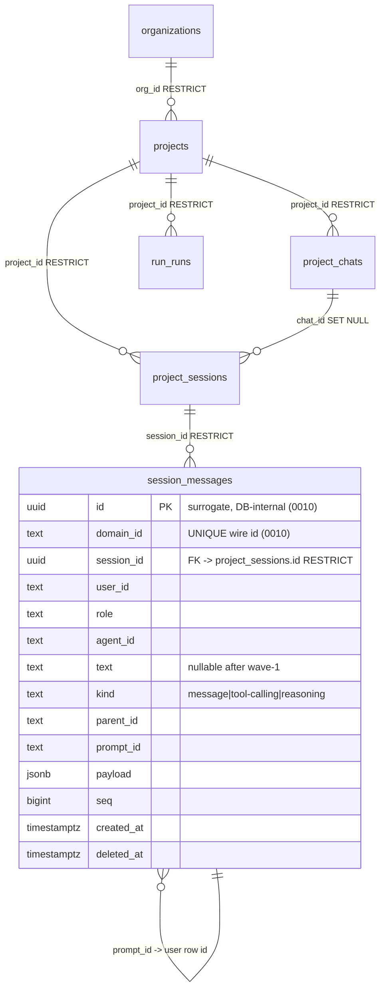

# DB-TABLES — структура таблиц после волны 1 (миграции 0009 + 0010)

Источник: `apps/backend/src/common/db/schema.ts` (код на момент чтения) и `PLAN-DETAIL.md` §C2, §C4, §6. Документ описательный, код не меняется.

> Chain 0009 (`0009_session_chain.sql`, решения пользователя 2026-11-10):
> `session_messages` = сообщения, `project_sessions` = чат, `projects` = проекты;
> `projects 1:N project_sessions 1:N session_messages` (оба RESTRICT);
> прямая связь `session_messages -> projects` УБРАНА (`project_id` удалён полностью);
> `session_id` text → uuid FK → `project_sessions.id` RESTRICT;
> orphan-строки (session_id не совпадает с `project_sessions.id`, в т.ч. все `ses_*`) — ДРОПНУТЫ;
> backfill/default-сессии НЕ делаются. Раздел §2 ниже (wave-1 `kind/payload/seq`) — план, не применён;
> фактическая 0009 — chain (см. §2.0).

Затрагиваемые таблицы: **`session_messages`** (основная). Связанные, но **не меняются** волной 1: `projects`, `project_chats`, `project_sessions`, `run_runs` — приведены ниже только как контекст FK/scope.

---

## 1. Текущая структура (до 0009)

### 1.1 `session_messages` (schema.ts: chain 0009)

| Колонка | Тип | NULL | Default | Примечание |
|---|---|---|---|---|
| `id` | text | NOT NULL | — | PK. Бэкенд: `receipt.id` (user) / `Bun.randomUUIDv7()` (assistant) |
| `session_id` | uuid | NOT NULL | — | FK → `project_sessions.id` ON DELETE RESTRICT (harness uuid; `ses_*` дропнуты 0009) |
| `user_id` | text | NOT NULL | — | FK-less (конвенция проекта) |
| `role` | text | NOT NULL | — | `user` \| `assistant` |
| `agent_id` | text | NULL | — | |
| `text` | text | NOT NULL | — | Текст сообщения |
| `created_at` | timestamptz | NOT NULL | `now()` | |
| `deleted_at` | timestamptz | NULL | — | soft-delete |

`project_id` — УДАЛЁН (0009): прямая связь `session_messages -> projects` убрана, scope — JOIN `project_sessions`.

Индексы:
- `session_messages_session_idx` on `(session_id, created_at)`
- PK `id`
- `session_messages_project_idx` — УДАЛЁН вместе с колонкой.

### 1.2 Контекст: связанные таблицы (не меняются)

| Таблица | Ключевые колонки | Связь с `session_messages` |
|---|---|---|
| `projects` | `id uuid PK`, `org_id uuid NOT NULL FK organizations RESTRICT`, `deleted_at` | НЕТ прямой связи (0009): scope через `project_sessions.project_id` → `projects.id` (RESTRICT) |
| `project_chats` | `id uuid PK`, `project_id uuid FK RESTRICT`, `title`, `deleted_at` | нет прямой связи (chat ↔ session через `project_sessions.chat_id`) |
| `project_sessions` | `id uuid PK`, `project_id uuid FK RESTRICT`, `chat_id uuid FK SET NULL`, `origin text default 'upstream'` | PARENT: `session_messages.session_id` → `project_sessions.id` (RESTRICT) |
| `run_runs` | `id uuid PK`, `project_id uuid FK RESTRICT`, `status`, `base_commit`, `branch`, `worktree` | не связана с сообщениями |

Важно: `session_messages.session_id` — uuid FK → `project_sessions.id` (chain 0009). `ses_*` и висячие uuid — орфаны, дропнуты миграцией.

---

## 2.0 Структура ПОСЛЕ chain-миграции 0009 (`0009_session_chain.sql`, факт)

```sql
-- Pre-check: COUNT орфанов
-- SELECT count(*) FROM session_messages m
--   LEFT JOIN project_sessions s ON s.id::text = m.session_id WHERE s.id IS NULL;
-- Backup-plan: pg_dump -t session_messages до apply.
DELETE FROM "session_messages" m USING (SELECT 1) AS _ WHERE NOT EXISTS (SELECT 1 FROM "project_sessions" s WHERE s."id"::text = m."session_id");--> statement-breakpoint
ALTER TABLE "session_messages" DROP CONSTRAINT IF EXISTS "session_messages_project_id_projects_id_fk";--> statement-breakpoint
DROP INDEX IF EXISTS "session_messages_project_idx";--> statement-breakpoint
DROP INDEX IF EXISTS "session_messages_session_idx";--> statement-breakpoint
ALTER TABLE "session_messages" DROP COLUMN IF EXISTS "project_id";--> statement-breakpoint
ALTER TABLE "session_messages" ALTER COLUMN "session_id" TYPE uuid USING "session_id"::uuid;--> statement-breakpoint
ALTER TABLE "session_messages" ADD CONSTRAINT "session_messages_session_id_project_sessions_id_fk" FOREIGN KEY ("session_id") REFERENCES "public"."project_sessions"("id") ON DELETE restrict ON UPDATE no action;--> statement-breakpoint
CREATE INDEX "session_messages_session_idx" ON "session_messages" USING btree ("session_id","created_at");
```

Что с `project_id`/орфанами/каскадами: `project_id` УДАЛЁН полностью (колонка, FK, индекс); орфаны ДРОПНУТЫ (без backfill/default-сессий); каскады RESTRICT на обоих плечах (`project_sessions.project_id → projects.id`, `session_messages.session_id → project_sessions.id`).

R-правила chain:
- R-C1: `session_messages.session_id` — uuid FK → `project_sessions.id` RESTRICT (валидация `ses_*` → дроп, каст `::uuid` после чистки).
- R-C2: прямой связи `session_messages → projects` НЕТ; project-scope — только JOIN `project_sessions` (`listMessages(sessionId, projectId?)`, `listSessionIdsWithMessages(projectId)`).
- R-C3: `projects 1:N project_sessions 1:N session_messages`; `project_chats 1:N project_sessions` via `chat_id SET NULL` без изменений.
- R-C4 (0010, 6.1): `session_agents.session_id` — uuid PK + FK → `project_sessions.id` RESTRICT; `ses_*`/orphan-строки ДРОПНУТЫ до каста (подтверждено); джойн `listLocalSessions` — прямой uuid-JOIN без `::text`.
- R-C5 (0010, 6.2 SURROGATE): `session_messages.id` — внутренний uuid PK (DB-owned, never leaves the DB); `domain_id` — стабильный wire id с UNIQUE; replay — `onConflictDoNothing(domain_id)`; wire-контракт (`SessionMessage.id`) НЕ меняется.
- R-C6 (0010, 6.3): индексы `project_sessions_project_idx (project_id)`, `project_sessions_project_origin_idx (project_id, origin)`, `session_agents_project_idx (project_id)` — все `IF NOT EXISTS`.

## 2.0b Структура ПОСЛЕ follow-up 0010 (`0010_session_agents_uuid_surrogate.sql`, факт)

```sql
-- Pre-checks: COUNT session_agents-орфанов; SELECT count(*) FROM session_messages WHERE id IS NULL (= 0).
-- Backup-plan: pg_dump -t session_agents -t session_messages до apply.
DELETE FROM "session_agents" a WHERE NOT EXISTS (SELECT 1 FROM "project_sessions" s WHERE s."id"::text = a."session_id");--> statement-breakpoint
ALTER TABLE "session_agents" ALTER COLUMN "session_id" TYPE uuid USING "session_id"::uuid;--> statement-breakpoint
DO $$ BEGIN ALTER TABLE "session_agents" ADD CONSTRAINT "session_agents_session_id_project_sessions_id_fk" FOREIGN KEY ("session_id") REFERENCES "public"."project_sessions"("id") ON DELETE restrict ON UPDATE no action; EXCEPTION WHEN duplicate_object THEN NULL; END $$;--> statement-breakpoint
ALTER TABLE "session_messages" DROP CONSTRAINT IF EXISTS "session_messages_pkey";--> statement-breakpoint
DO $$ BEGIN ALTER TABLE "session_messages" RENAME COLUMN "id" TO "domain_id"; EXCEPTION WHEN undefined_column THEN NULL; END $$;--> statement-breakpoint
ALTER TABLE "session_messages" ADD COLUMN IF NOT EXISTS "id" uuid DEFAULT gen_random_uuid() NOT NULL;--> statement-breakpoint
UPDATE "session_messages" SET "id" = gen_random_uuid() WHERE "id" IS NULL;--> statement-breakpoint
DO $$ BEGIN ALTER TABLE "session_messages" ADD PRIMARY KEY ("id"); EXCEPTION WHEN duplicate_object THEN NULL; END $$;--> statement-breakpoint
DO $$ BEGIN ALTER TABLE "session_messages" ADD CONSTRAINT "session_messages_domain_id_unique" UNIQUE("domain_id"); EXCEPTION WHEN duplicate_object THEN NULL; END $$;--> statement-breakpoint
CREATE INDEX IF NOT EXISTS "project_sessions_project_idx" ON "project_sessions" USING btree ("project_id");--> statement-breakpoint
CREATE INDEX IF NOT EXISTS "project_sessions_project_origin_idx" ON "project_sessions" USING btree ("project_id","origin");--> statement-breakpoint
CREATE INDEX IF NOT EXISTS "session_agents_project_idx" ON "session_agents" USING btree ("project_id");
```

Что с `ses_*`/PK/индексами: `session_agents`-орфаны (все `ses_*`) ДРОПНУТЫ до каста; `session_messages.id` text PK → `domain_id` (UNIQUE, wire id) + новый uuid PK `id`; три индекса 6.3 — `IF NOT EXISTS`. Wave-1 UNIQUE по `seq`/`callId` НЕ в scope (колонок `kind`/`payload`/`seq` нет — §2 ниже остаётся планом).

## 2. Структура ПОСЛЕ миграции 0009 (wave-1 план `session_entries`, НЕ применён)

### 2.1 `session_messages` — полная таблица колонок

| Колонка | Тип | NULL | Default | Статус | Назначение |
|---|---|---|---|---|---|
| `id` | text | NOT NULL | — | без изменений | PK |
| `session_id` | text | NOT NULL | — | без изменений | Доменный id сессии |
| `project_id` | uuid | NOT NULL | — | без изменений | FK → `projects.id` RESTRICT |
| `user_id` | text | NOT NULL | — | без изменений | |
| `role` | text | NOT NULL | — | без изменений | `user` \| `assistant` (для tool/reasoning — см. §3) |
| `agent_id` | text | NULL | — | без изменений | |
| `text` | text | **NULL** | — | **изменено**: `DROP NOT NULL` | Текст; NULL для `tool-calling` |
| `created_at` | timestamptz | NOT NULL | `now()` | без изменений | |
| `deleted_at` | timestamptz | NULL | — | без изменений | soft-delete |
| `kind` | text | NOT NULL | `'message'` | **новая** | `message` \| `tool-calling` \| `reasoning` |
| `parent_id` | text | NULL | — | **новая** | id предыдущего узла той же `session_id` (связный список) |
| `prompt_id` | text | NULL | — | **новая** | id user-узла хода (группировка по промпту) |
| `payload` | jsonb | NULL | — | **новая** | Данные `tool-calling` (см. §4); NULL для message/reasoning |
| `seq` | bigint | NULL до backfill | — | **новая** | Порядковый номер внутри `session_id` |

Новые индексы:
- `session_messages_session_seq_idx` on `(session_id, seq)`
- `session_messages_session_prompt_idx` on `(session_id, prompt_id)`
- Старые `session_messages_session_idx (session_id, created_at)` и `session_messages_project_idx (project_id)` **сохраняются**.

Примечание по `seq` NULL: после DDL колонка nullable (нет ограничения NOT NULL до backfill). Ужесточение до NOT NULL не входит в 0009 (не указано в плане) — см. открытые вопросы.

Значения `kind` в БД: `message`, `tool-calling`, `reasoning`. Контрактный `user` = `kind='message' AND role='user'`; `agent-message` = `kind='message' AND role='assistant'` (решение PLAN-DETAIL §C2, минимизирует миграцию).

### 2.2 Контекст после миграции

`projects`, `project_chats`, `project_sessions`, `run_runs` — без изменений.

---

## 3. Примеры строк

Условные значения: `session_id = 'ses_8fQx21'`, `project_id = '7c1e0a52-…'`, `user_id = 'u_42'`. `id` для user — `receipt.id` (uuidv7), для assistant/tool — uuidv7.

| id | session_id | kind | role | prompt_id | parent_id | seq | text | payload |
|---|---|---|---|---|---|---|---|---|
| `0190a1f0-0001-7000-…` | ses_8fQx21 | message | user | `0190a1f0-0001-7000-…` (= own id) | NULL | 1 | «Прочитай README и найди TODO» | NULL |
| `0190a1f0-0002-7000-…` | ses_8fQx21 | tool-calling | assistant | `0190a1f0-0001-7000-…` | `0190a1f0-0001-7000-…` | 2 | NULL | `{"tool":"read","callId":"toolu_01A","input":{"path":"README.md"},"status":"success","result":"# Rush…"}` |
| `0190a1f0-0003-7000-…` | ses_8fQx21 | tool-calling | assistant | `0190a1f0-0001-7000-…` | `0190a1f0-0002-7000-…` | 3 | NULL | `{"tool":"grep","callId":"toolu_01B","input":{"pattern":"TODO"},"status":"called"}` |
| `0190a1f0-0004-7000-…` | ses_8fQx21 | reasoning | assistant | `0190a1f0-0001-7000-…` | `0190a1f0-0003-7000-…` | 4 | «Нужно сравнить найденные TODO с…» | NULL |
| `0190a1f0-0005-7000-…` | ses_8fQx21 | message | assistant | `0190a1f0-0001-7000-…` | `0190a1f0-0004-7000-…` | 5 | «Нашёл 3 TODO в README и src/…» | NULL |

Пояснения по строкам:
- **user-промпт** (seq 1): `prompt_id` = собственный `id`, `parent_id` = NULL (первый узел), `payload` NULL.
- **tool-calling, called → success** (seq 2): одна строка, статус обновляется in-place через `updateEntryStatus` по `(session_id, payload->>'callId')`. Показан итог `success`. Промежуточный `called` — та же строка до `tool-result`.
- **tool-calling, called** (seq 3): ещё не завершён (`status='called'`, без `result`).
- **reasoning** (seq 4): `text` содержит reasoning-текст, `payload` NULL.
- **agent-message** (seq 5): `kind='message'`, `role='assistant'`, `prompt_id` = user-промпт хода, `parent_id` = предыдущий узел.

Для обычных legacy-строк (до миграции) после backfill: `kind='message'`, `payload` NULL, `seq` и `prompt_id` заполнены backfill-ом.

---

## 4. Значения `kind` и формат `payload`

| kind | text | payload | role |
|---|---|---|---|
| `message` | обязателен (текст) | NULL | `user` или `assistant` |
| `tool-calling` | NULL | обязателен (см. ниже) | `assistant` |
| `reasoning` | обязателен | NULL | `assistant` |

### 4.1 Payload `tool-calling`

```json
{
  "tool": "read",
  "callId": "toolu_01A",
  "input": { "path": "README.md" },
  "status": "called" | "success" | "failed",
  "result": "…(опционально, обрезано)…",
  "error": "…(опционально, только при failed)…"
}
```

| Поле | Тип | Обязательно | Источник |
|---|---|---|---|
| `tool` | string | да | имя инструмента (auto: `ToolCall.name`; host: имя из кадра) |
| `callId` | string | да | auto: `ToolCall.id` (= `settlement.callID`), не синтетический |
| `input` | any JSON | нет | `ToolCall.arguments`, **после санитизации** |
| `status` | enum | да | `called` → `success`/`failed` |
| `result` | string | нет | `tool-result`, **после санитизации** |
| `error` | string | нет | только при `status='failed'` (`result.startsWith('error:')`) |

**Санитизация (`sanitizeToolPayload`, PLAN-DETAIL Open Q 1):**
- строки обрезаются до 4 КБ с суффиксом `…[truncated]`;
- ключи, совпадающие с `/(token|secret|password|key|authorization|cookie)/i`, заменяются на `"[redacted]"`;
- `result` сохраняется только для allowlist-инструментов (read/list/grep по умолчанию); для write/bash — только `status` и длина;
- логи: `input`/`result` не логируются (T-BE-9).

### 4.2 Payload прочих kind

`message` и `reasoning` — `payload` NULL. Новые поля в payload без миграции допустимы (jsonb), но контракт должен быть обновлён синхронно (C3).

---

## 5. Правила целостности

| # | Правило | Как обеспечивается | Проверка |
|---|---|---|---|
| R1 | user-строка: `prompt_id = id` | запись user-узла (`id: receipt.id`, `prompt_id: receipt.id`); backfill `UPDATE … SET prompt_id = id WHERE role='user'` | T-DB-9 |
| R2 | `parent_id` ссылается на предыдущий узел **той же** `session_id` (или NULL для первого) | курсор `lastNodeId` в `runTurn`; `appendEntry` | T-BE-1 (цепочка) |
| R3 | `seq` монотонен и без пропусков внутри `session_id`, начинается с 1 | `appendEntry`: `SELECT coalesce(max(seq),0)+1 … FOR UPDATE` (или advisory lock по sessionId) | T-DB-1, T-DB-6 |
| R4 | `tool-calling` уникален по `(session_id, payload->>'callId')` | upsert `findEntryByCallId` перед вставкой | T-DB-3, T-DB-4 |
| R5 | assistant-строки после backfill имеют `prompt_id` = ближайший предыдущий user той же сессии | backfill (подзапрос по `created_at <= …`) | T-DB-9 |
| R6 | `kind='tool-calling'` ⇒ `payload` NOT NULL и содержит `callId`, `tool`, `status` | уровень приложения + zod (C3). В БД CHECK не предусмотрен планом | T-CT-2 |
| R7 | `kind='message'` ⇒ `text` NOT NULL | уровень приложения (text стал nullable, поэтому БД сама не гарантирует) | T-BE-* |
| R8 | `listMessages` видит только `kind='message'` | фильтр в repository (C4a) | T-DB-5 |

Рекомендация (не входит в PLAN-DETAIL, требует решения): партиальный unique-индекс для R4 —
`CREATE UNIQUE INDEX session_messages_session_callid_uidx ON session_messages (session_id, (payload->>'callId')) WHERE kind = 'tool-calling';` и unique `(session_id, seq)`. Без них уникальность держится только в коде и гонка возможна.

---

## 6. SQL DDL до / после и backfill

### 6.1 DDL ДО (фактическая схема на 0008)

```sql
CREATE TABLE "session_messages" (
  "id"          text PRIMARY KEY NOT NULL,
  "session_id"  text NOT NULL,
  "project_id"  uuid NOT NULL,
  "user_id"     text NOT NULL,
  "role"        text NOT NULL,
  "agent_id"    text,
  "text"        text NOT NULL,
  "created_at"  timestamp with time zone DEFAULT now() NOT NULL,
  "deleted_at"  timestamp with time zone
);
ALTER TABLE "session_messages" ADD CONSTRAINT "session_messages_project_id_projects_id_fk"
  FOREIGN KEY ("project_id") REFERENCES "projects"("id") ON DELETE restrict ON UPDATE no action;
CREATE INDEX "session_messages_session_idx" ON "session_messages" ("session_id", "created_at");
CREATE INDEX "session_messages_project_idx" ON "session_messages" ("project_id");
```

### 6.2 DDL ПОСЛЕ (миграция 0009, PLAN-DETAIL §C2)

```sql
-- 1. Новые колонки (аддитивно, идемпотентно)
ALTER TABLE "session_messages" ADD COLUMN IF NOT EXISTS "kind"      text NOT NULL DEFAULT 'message';
ALTER TABLE "session_messages" ADD COLUMN IF NOT EXISTS "parent_id" text;
ALTER TABLE "session_messages" ADD COLUMN IF NOT EXISTS "prompt_id" text;
ALTER TABLE "session_messages" ADD COLUMN IF NOT EXISTS "payload"   jsonb;
ALTER TABLE "session_messages" ADD COLUMN IF NOT EXISTS "seq"       bigint;

-- 2. text становится nullable (для tool-calling)
ALTER TABLE "session_messages" ALTER COLUMN "text" DROP NOT NULL;

-- 3. Индексы (до backfill; для большой таблицы — CREATE INDEX CONCURRENTLY вне транзакции)
CREATE INDEX IF NOT EXISTS "session_messages_session_seq_idx"    ON "session_messages" ("session_id", "seq");
CREATE INDEX IF NOT EXISTS "session_messages_session_prompt_idx" ON "session_messages" ("session_id", "prompt_id");
```

### 6.3 Backfill (отдельный шаг, идемпотентный)

```sql
-- a) seq: порядок по created_at, id внутри session_id
UPDATE "session_messages" m SET "seq" = r.rn
FROM (
  SELECT id, row_number() OVER (PARTITION BY session_id ORDER BY created_at, id) AS rn
  FROM "session_messages"
) r
WHERE m.id = r.id AND m.seq IS NULL;

-- b) user: prompt_id = собственный id
UPDATE "session_messages" SET "prompt_id" = "id"
WHERE "role" = 'user' AND "prompt_id" IS NULL;

-- c) assistant: prompt_id = ближайший предыдущий user той же сессии
UPDATE "session_messages" a SET "prompt_id" = (
  SELECT u.id FROM "session_messages" u
  WHERE u.session_id = a.session_id AND u.role = 'user' AND u.created_at <= a.created_at
  ORDER BY u.created_at DESC LIMIT 1
)
WHERE a.role = 'assistant' AND a.prompt_id IS NULL;
```

Замечания:
- `parent_id` для legacy-строк в backfill **не заполняется** в плане (остаётся NULL). Связный список для старых сессий не восстанавливается — допустимо, т.к. старые сессии состоят только из текста. Если потребуется — отдельный шаг по `seq`: `parent_id = предыдущая строка по seq`.
- Батчи по `session_id` для больших таблиц (PLAN-DETAIL §8).
- Миграция на копии БД (пустой и с данными) — гейт T-DB-9.

### 6.4 Откат (PLAN-DETAIL §C2)

```sql
DROP INDEX IF EXISTS "session_messages_session_seq_idx", "session_messages_session_prompt_idx";
ALTER TABLE "session_messages"
  DROP COLUMN "kind", DROP COLUMN "parent_id", DROP COLUMN "prompt_id",
  DROP COLUMN "payload", DROP COLUMN "seq";
-- только если нет строк с NULL text:
-- SELECT count(*) FROM session_messages WHERE text IS NULL;  -- должно быть 0
ALTER TABLE "session_messages" ALTER COLUMN "text" SET NOT NULL;
```

Предпочтительно: оставить колонки, откатить код (PLAN-DETAIL §5).

### 6.5 Drizzle-схема после (schema.ts, целевой вид колонок)

```ts
kind: text("kind").notNull().default("message"),
parentId: text("parent_id"),
promptId: text("prompt_id"),
payload: jsonb("payload").$type<Record<string, unknown> | null>(),
seq: bigint("seq", { mode: "number" }),
text: text("text"),            // без .notNull()
// indexes: + session_messages_session_seq_idx (session_id, seq),
//          + session_messages_session_prompt_idx (session_id, prompt_id)
```

---

## 7. Диаграмма связей



Текстом:
- `projects 1—N project_sessions` (RESTRICT), `project_sessions 1—N session_messages` (RESTRICT, chain 0009).
- Прямой связи `projects — session_messages` НЕТ (project_id удалён).
- Внутри `session_messages` (wave-1 план): `parent_id` → предыдущий узел той же `session_id` (граф-цепочка); `prompt_id` → user-строка того же хода (`prompt_id = id` у user).
- `session_messages.session_id` → `project_sessions.id` — FK RESTRICT (chain).

---

## 8. Открытые вопросы

1. `seq` оставить nullable или `SET NOT NULL` после backfill (отдельная миграция 0010)? План не решает.
2. Добавить ли партиальный unique `(session_id, payload->>'callId') WHERE kind='tool-calling'` и unique `(session_id, seq)` в 0009 (см. §5)?
3. Нужен ли `parent_id` для legacy-строк (backfill по `seq`)? Default по плану — нет.
4. Нужен ли CHECK на `kind IN ('message','tool-calling','reasoning')`? В плане не указан; по аналогии с `vault_secrets_consumer_type_check` — рекомендуется.
