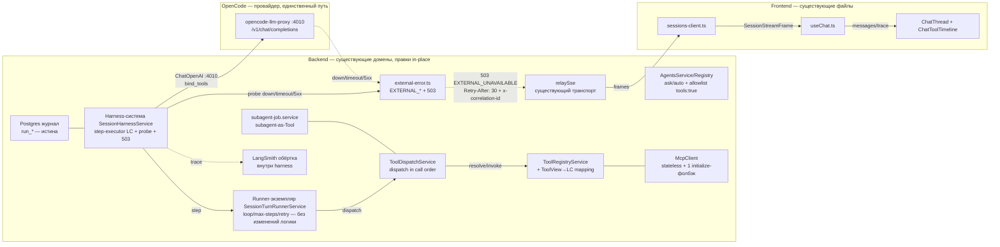

Superseded (в части LLM-слоя): см. .plans/langchain-openrouter-migration/PLAN.md (объединённый план)

# План переделки текущей системы под LangChain in-place (ДОКУМЕНТ)

Частично superseded: см. .plans/langchain-openrouter-unified/PLAN.md

> Директория: `.plans/langchain-bridge-k7/` (эпохи `epoch-01..09.md`). Только план, кода нет.
> База: `baseCommit 0300575`, ветка `feat/chat-commit-cur` (Forward-Only, файлы плана код не трогают).
> Board `Web2bizz/rush-code` — инфо; карточки не создавать (формат документ по явному выбору).
> Канон: `apps/backend/AGENTS.md` + `CODE_OF_CONDUCT.md` (CoC-структура, `AppLogger`, C4-gate, `__tests__/`), `packages/contracts/AGENTS.md` (зеркало `contracts/openapi.yaml`), ADR-0001/0002, `docs/opencode-embedded-spike.md`.
> `longchain` = `langchain` (опечатка исходной постановки).
>
> **ЗАПРЕТ Epoch 7 (in-place): новый модуль/домен НЕ создаётся.**
> `apps/backend/src/processes/modules/workers/modules/langchain/` (`langchain.module.ts`, `langchain-gateway.service.ts`, `opencode-proxy.model.ts`, `lc-tools.adapter.ts`, `lc-tracing.setup.ts`) — НЕ создавать.
> Переключатель `MODEL_GATEWAY=stub|langchain` как новый путь/рантайм-фолбэк — НЕ вводить.
> Вся переделка — правки существующих файлов/доменов (sessions = чаты, harness = система `SessionHarnessService`, runner = экземпляр цикла `SessionTurnRunnerService`, agents, tools, workers/tool-registry, common/sse, common/external, opencode-billing, sessions-client/useChat/ChatThread/Timeline; см. §0 Глоссарий, код не переименовывается).
> Сохраняется: LangChain — ядро управления (библиотека внутри существующих сервисов, не домен), OpenCode-провайдер через прокси `:4010` — primary и единственный прод-путь, только paid/Go `tools:true`, при недоступности OpenCode — честный 503, fallback запрещён.
>
> **ИНВАРИАНТ Epoch 9 (config-isolation, решение: поведение ранее не задано): новый harness игнорирует opencode-конфиги.** `opencode.json` (известный носитель в репо: `.opencode/opencode.json`; иные носители — [???], точный список не зафиксирован, не выдумывать) — harness не читает, не парсит, совместимость не гарантируется; при наличии конфигов — молча игнорировать (без чтения), без варнингов в прод-пути. Источник настроек harness — только env/код/существующие домены (см. `epoch-09.md`).

## 0. Глоссарий (нормативен для всего документа; код не переименовывается)

> Правило Epoch 8: `session` — только чат, `harness` — только система, `runner` — только экземпляр цикла.
> Смешения старых эпох (`harness` как процесс, `runner` как система, `session` как состояние/хранилище) читать по этому глоссарию.
> Кодовые имена (`SessionHarnessService`, `SessionTurnRunnerService`, `session-*`) НЕ переименовываются — ниже только маппинг «термин → кодовый носитель».

| Термин | Значение в этом документе | Кодовый носитель (без переименования) |
|--------|---------------------------|----------------------------------------|
| `session` | только чат пользователя с ИИ (создание/список/сообщения/поток). НЕ состояние провайдера, НЕ хранилище само по себе | `SessionInfo`/`SessionMessage`/`sessionId` (`sessions.dto.ts`), `SessionsService` (тонкий фасад), `session-history.repository.ts` + `run_*` (журнал чата как истина), `api/sessions-client.ts` + `useChat.ts` + `ChatThread/Timeline` (фронт чата) |
| `harness` | только агентская система: управляет агентами, инструментами, MCP, инструкциями; владеет LC step-executor, probe и 503. НЕ процесс, НЕ цикл | `SessionHarness` (`session-harness.types.ts`: orchestrator за `/api/v1/sessions*`) → `SessionHarnessService` (`session-harness.service.ts`, 1581 строк) |
| `runner` | только процесс harness — экземпляр цикла/обёртка `шаг → dispatch → nextRequest` (бюджеты/ретраи). НЕ система | `SessionTurnRunnerService.runTurn` (`modules/runner/runner.service.ts`) + `loop.ts` + `max-steps.ts` + `retry.ts` (логика без изменений) |
| `freeze/stop/kill/run` | только определение управления runner (пауза/останов/убийство/запуск экземпляра цикла: `interrupt`/`finishReason 'stop'`/`runTurn`). НЕ новый скоуп работ Epoch 7 — реализаций не добавляем, поведения не меняем | существующие `interrupt()`, `runTurn()`, `max-steps`/`retry` — без изменений |

- Канон-ссылки (без правок кода): `apps/backend/AGENTS.md` + `CODE_OF_CONDUCT.md` (CoC-структура, `AppLogger`, C4-gate, `__tests__/`), `packages/contracts/AGENTS.md` (зеркало `contracts/openapi.yaml`), ADR-0001/0002, `docs/opencode-embedded-spike.md`.
- Чтение диаграмм/этапов ниже: `H` = harness-система (`SessionHarnessService`), `R` = runner-экземпляр (`SessionTurnRunnerService`), `session` = чат; `прод-путь`/`LC-путь`/`harness-step` = шаг LC внутри harness-системы, исполняемый через runner-экземпляр (не отдельные сущности).

## 1. Целевая архитектура (LangChain in-place, без нового домена)



- **LangChain — библиотека внутри существующих сервисов, не домен.** LC/LangGraph-JS (`@langchain/core`, `@langchain/openai`, `langgraph`) вызывается из `SessionHarnessService` (новый step-executor: `ChatOpenAI({baseURL: :4010/v1})` → `bind_tools(ToolView[])` → цикл шаг→dispatch→nextRequest через существующий `SessionTurnRunnerService`), без `workers/modules/langchain/`, без `LangChainGateway extends ModelGateway`, без `MODEL_GATEWAY`-переключателя. `ModelGateway.stream`/`Executor`/`StubModelGateway` прототипа не трогаем как границу run-engine; прод-путь чата — harness/runner, stub живёт только как до-миграционное состояние вне LC-пути до зелёного E2E (не рантайм-фолбэк при proxy down).
- **OpenCode — провайдер (единственный прод-путь).** Только прокси `:4010` как `BaseChatModel`; serve Tool как fallback-ветка ЗАПРЕЩЕНА (`opencode-serve.tool.ts` не создаётся, `OpencodeHostService`/embedded SDK не в LC-пути, выбора `need.toolCalls + health` нет). Consumers `sessions/*`, `OPENCODE_URL`, stub — до Этапа 4 только как legacy вне LC-пути, НЕ как runtime-fallback при proxy down.
- **Отказ — честный 503 (backend-канон, без тихих фолбэков).** При недоступности/неработоспособности OpenCode (proxy down, host down, 5xx, таймаут) — `EXTERNAL_UNAVAILABLE` 503 + `Retry-After: 30` + `x-correlation-id` из существующего `common/external/external-error.ts`; без retry внутри harness-step (retry решает вызывающий через `runner/retry.ts` политику шагов, не повтор отказавшего апстрима); без перехода на stub/serve/CLI. Probe уже есть в `session-harness.service.ts` (`streamEvents` → `relaySse.probe` → `host.getHost()` → `EXTERNAL_UNAVAILABLE` до SSE-заголовков) — расширяется на send-путь.
- **Config-isolation (инвариант Epoch 9, решение — поведение ранее не задано).** Новый harness игнорирует opencode-конфиги: `opencode.json` (известный носитель в репо — `.opencode/opencode.json`; иные носители — [???], точный список не зафиксирован, не выдумывать) — не читает, не парсит, совместимость не гарантируется; при наличии конфигов — молча игнорировать (без чтения), без варнингов в прод-пути. Источник настроек harness — только env/код/существующие домены.
- **Инструменты — существующий реестр, LC видит только проекцию.** `ToolRegistryService.listForPrompt/resolve` + `ToolDispatchService.dispatch` остаются исполнением (sha/порядок/concurrency-пул — без изменений); маппинг `ToolDefinition/ToolView → DynamicStructuredTool` — несколько строк внутри `tools.bootstrap.ts`/`tool-registry.service.ts`, отдельного `lc-tools.adapter.ts` нет. Subagent — как Tool через существующий `subagent-job.service.ts` (`run → ToolSettlement`). `.opencode/tools/*.ts` (22 шт.) — регистрация через существующий `tools.bootstrap.ts`, single source — скрипты `scripts/*/run.sh`, input-schema не менять.
- **MCP общий, без своего сервера.** Существующий `workers/modules/tool-registry/mcp-client.ts` (stateless + 1 `initialize`-фолбэк) + `mcp-tool-source.ts` — тот же URL-каталог для LC (`MultiServerMCPClient` поверх него на стороне harness-step, не новый модуль); своего MCP-сервера нет (D5).
- **Наблюдаемость — существующая + LangSmith поверх.** `AppLogger + x-correlation-id`, `relaySse` (heartbeat `15s`, `id:`, терминальный `stream.error`, `Last-Event-ID`/cursor redial), `session-harness` replay — без изменений; LangSmith (`LANGSMITH_TRACING/API_KEY/PROJECT` + `langsmith-opencode` шлейф) — обёртка вызовов внутри `session-harness.service.ts`, не `lc-tracing.setup.ts`.
- **Память — прод resume из нашего журнала.** `MemorySaver` — только dev/e2e пилота внутри harness-step; прод — `run_steps/run_events` + `session-history.repository.ts`; LangGraph replay пере-исполняет LLM — запрещён FR6 (`intent → confirm` сохраняется).

## 2. Этапы переделки in-place (порядок, зависимости, что трогаем)

```
Э0 Пилот ──→ Э1 Harness-step (без fallback) ──→ Э2 Tools ──→ Э3 Честный 503 ──→ Э4 Харденинг ──→ (Э5 Чистка — отдельно)
```

| Этап | Правим in-place (существующие файлы) | Не создаём / не трогаем | Зависимость | Выход |
|------|--------------------------------------|--------------------------|-------------|-------|
| **Э0 Пилот** | deps (`@langchain/core`, `@langchain/openai`, `langgraph`, `@langchain/mcp-adapters`/`@modelcontextprotocol/sdk`, `langsmith`); прокси sidecar `:4010` в compose/стенде; LC step-executor внутри `session-harness.service.ts` (вне прод-пути за локальным флагом пилота); 1 e2e `bind_tools` (paid/Go `tools:true`: `tool_calls` → `ToolDispatchService.dispatch` → результат в цикл `SessionTurnRunnerService`) | новый домен, `MODEL_GATEWAY`-переключатель, прод-путь | — | `__tests__/langchain-harness-step.e2e.ts` зелёный: `tool_calls[]` → `dispatch(git.recon …)` → результат вернулся в `runTurn` |
| **Э1 Harness-step (без fallback)** | `session-harness.service.ts` (LC step как единственный прод-путь шага); `agents/model-fallback.ts` + `agents.registry.ts` (allowlist paid/Go `tools:true`, гейт `need.toolCalls` до вызова); `common/external/external-error.ts` (маппинг 400/422→BAD_REQUEST, 404→NOT_FOUND, 403/5xx/таймаут/proxy down/host down→503 `EXTERNAL_UNAVAILABLE` + `Retry-After: 30` + `x-correlation-id`, без retry внутри); LangSmith-обёртка внутри harness | `MODEL_GATEWAY=stub` как рантайм-переключатель (запрещён); `runner/loop.ts`, `max-steps.ts`, `retry.ts` — логика без изменений; stub — лишь до-миграционное состояние вне LC-пути | ← Э0 | free/beelding → fail-fast 503 до вызова; paid → trace в LangSmith; proxy down → 503 без перехода на stub |
| **Э2 Tools** | `tools/tool-registry.service.ts` + `tools.bootstrap.ts` (ToolView→LC маппинг, регистрация `.opencode/tools` через существующий путь); `tools/tool-dispatch.service.ts` — без изменений логики (порядок/concurrency/error-result); `agents/modules/subagent/subagent-job.service.ts` (subagent-as-Tool без мутаций сессий); `workers/modules/tool-registry/mcp-client.ts` + `mcp-tool-source.ts` (общий каталог для LC) | `lc-tools.adapter.ts`, custom-tools HTTP-сервис как новый модуль, свой MCP-сервер | ← Э1 | `git.recon` + 1 custom + 1 MCP tool через LC step end-to-end |
| **Э3 Честный 503** | `session-harness.service.ts` (health-probe `:4010` на send-пути + существующий probe в `streamEvents`; маппинг `EXTERNAL_UNAVAILABLE` + e2e на 503 `Retry-After: 30`, `x-correlation-id`, без retry внутри); `common/sse/sse-relay.ts` — без изменений (терминальный `stream.error` сохраняется); serve-Tool ветка НЕ реализуется | `opencode-serve.tool.ts`, `OpencodeHostService` в LC-пути, выбор primary/fallback по `need.toolCalls` + health | ← Э2 | e2e с остановленным прокси → 503 + `Retry-After: 30` + correlation, без тихого фолбэка |
| **Э4 Харденинг** | `session-history.repository.ts` + `common/db/schema.ts` (журнал-как-истина, `intent → confirm`, fencing `SKIP LOCKED`); `api/sessions-client.ts` + `hooks/useChat.ts` + `chat-thread/ChatThread.tsx` + `chat-tool-timeline/ChatToolTimeline.tsx` (честное отображение 503 через `toErrorMessage`/`formatError` + `ErrorState` retry, без новых компонентов; контракт фреймов — только additive); `packages/contracts` + `contracts/openapi.yaml` (зеркало, только additive optional); CoC/lint/build, доки, e2e-скан секретов | новые компоненты/страницы, breaking контрактов | ← Э3 | `bun run lint/test/build` + graceful-restart resume без повтора эффектов; redial с cursor — без дублей/утечек |
| **(Э5 Чистка)** | — | stub/legacy — только отдельным решением + human approve | ← Э4 | не в скоупе этого документа |

- Параллелить нельзя: Э1 пишет step внутрь harness из Э0; Э2 — маппинг поверх step из Э1; Э3 — 503-контракт поверх Э2; Э4 — приёмка всего.
- Откат `MODEL_GATEWAY=stub` как runtime-fallback ЗАПРЕЩЁН (переключателя нет — откатываться нечему); Forward-Only без переписывания истории; `git merge-base --is-ancestor 0300575 HEAD` на каждом этапе.

## 3. Матрица вариантов LC↔OC in-place (когда/как + ограничения)

| # | Направление/вариант | Когда применять | Как (in-place, существующие файлы) | Ограничения (жёстко) |
|---|---------------------|-----------------|-------------------------------------|----------------------|
| V1 | **LC→OC primary (единственный прод-путь): прокси как `BaseChatModel` внутри harness-step** | всегда в прод-пути, когда нужен `bind_tools`/`tool_calls`; при недоступности — честный 503, без перехода на V2/V3/stub | `session-harness.service.ts` строит `ChatOpenAI({baseURL: <proxy>:4010/v1, model: <allowlist>})` → `bind_tools(ToolView[])` → шаг отдаётся в `SessionTurnRunnerService.runTurn` как `StepExecutor`; `ToolDispatchService.dispatch` исполняет; proxy down/host down/5xx/таймаут → `EXTERNAL_UNAVAILABLE` 503 + `Retry-After: 30` + `x-correlation-id` из `external-error.ts`, без retry внутри | Прокси `KochC/opencode-llm-proxy v1.11.2` под v2; serve `:4096` напрямую как OpenAI — ЗАПРЕЩЁН (свой OpenAPI `/session/:id/message`, `/event`, `/doc`); прокси stateless — история в `messages` из журнала (`session-history.repository.ts`), session state только наш журнал; модели только `tools:true` paid/Go (claude-sonnet/opus/haiku-5/4, gpt-6.1/6/5.5/5.4, gemini-4/3.x, kimi-k2.7, minimax-m3, glm-5.x, qwen, deepseek); `jev/free/image/embedding` — исключить; free вне OpenCode → 403 → fail-fast 503; fallback запрещён |
| V2 | **LC→OC fallback: serve Tool — ЗАПРЕЩЁН, не реализовывать** | НЕ ПРИМЕНЯТЬ ни при каких условиях (proxy down / health fail / модель без `tools:true` → честный 503, а не serve) | НЕ ДЕЛАТЬ: нет `opencode-serve.tool.ts`, нет `ToolDescriptor`-обёртки над `sessions.prompt/interrupt/messages`, нет `OpencodeHostService` в LC-пути, нет выбора по `need.toolCalls` + health | Тихие фолбэки нарушают backend-канон fail-fast; serve вне `bind_tools` (агент видел бы текст, не `tool_calls`) + `events.subscribe` live-only без replay |
| V3 | **LC→OC tertiary: CLI — НЕ fallback прод-пути** | только офлайн/дебаг, ручные прогоны; при недоступности прокси в прод-пути — 503, НЕ CLI | headless `opencode run` обёртка, вывод → строка (вне harness-пути) | Не для прод-пути: процессный, нестриминговый, ломает журнал/SSE; как замена прокси запрещён |
| V4 | **OC→LC: custom tools `.opencode/tools/*.ts` (22 шт.) — регистрация in-place** | когда LC-шагу нужен `boards/check/classify_*/git_changes/task_*/worktree/...` | регистрация через существующий `tools.bootstrap.ts` → `ToolRegistryService.registerAll`; исполнение — существующий `ToolDispatchService` (через `Bun.spawn(["bash", script])` как сейчас) | Single source — скрипты `scripts/*/run.sh`; input-schema не менять (совместимость с OC); секреты/корень — через `directory/worktree/cwd`; нового HTTP-сервиса/модуля нет |
| V5 | **Sidecar MCP (общий, in-place)** | внешние MCP-инструменты для harness-step | существующие `mcp-client.ts` (`listTools`/`callTool`) + `mcp-tool-source.ts` на тот же каталог URL; LC — `MultiServerMCPClient` поверх того же каталога внутри harness-step; долгие — `tasks/get` поллинг | Своего MCP-сервера нет (D5); Sampling не использовать (deprecated); legacy SSE — только 1 `initialize`-фолбэк; нового модуля нет |
| V6 | **Трейсинг LangSmith поверх существующего (без нового файла)** | все LC-вызовы Э1+ | env `LANGSMITH_TRACING/API_KEY/PROJECT` + обёртка runs внутри `session-harness.service.ts`; корреляция `x-correlation-id` обязательна | Не заменяет `AppLogger`; тела кадров/ключи/Bearer/URL в логи — запрещены (e2e-скан); OTel GenAI semconv нестабильны — маппинг изолировать; `lc-tracing.setup.ts` не создавать |

## 4. Риски и проверки (E2E bind_tools, регресс, CoC)

**Риски:**

| ID | Риск | Фактор | Митигация |
|----|------|--------|-----------|
| R1 | Прокси wire mismatch (`tool_calls`/SSE) с v2 в harness-step | external | Э0 e2e `bind_tools` внутри `session-harness.service.ts` step на paid/Go `tools:true`; health-probe `:4010` с честным 503 (serve-фолбэк запрещён); версия прокси зафиксирована `v1.11.2` |
| R2 | 403 free / silent-no-tools (`tools:false`) / proxy down | security/external | allowlist paid/Go `tools:true` + гейт в `agents/model-fallback.ts` + `agents.registry.ts` до вызова; free/beelding/proxy down/host down/5xx/таймаут → `EXTERNAL_UNAVAILABLE` 503 + `Retry-After: 30` + `x-correlation-id` (`external-error.ts`), без retry внутри и без перехода на stub/serve; jev/free/image/embedding в denylist |
| R3 | Повтор side effects при resume (LC replay) | data | прод-память — только журнал (`session-history.repository.ts`, `run_steps/run_events`); `SessionTurnRunnerService` (`loop/max-steps/retry`) без изменений — `intent → confirm`, трейлер как identity, sha как наблюдения; `MemorySaver` только dev пилота |
| R4 | Утечка секретов/проектов (ключи, чужие сессии) | security | e2e-скан секретов (расширить `keys.e2e.ts` на `LANGSMITH_*`/proxy: без Bearer/URL в логах); C4-gate первый; `?session=`-изоляция; `AppLogger` без тел/секретов, `warn/error` без `\n` |
| R5 | Breaking контрактов/фронта (in-place регресс живого чата) | breaking | зеркало `openapi.yaml` ↔ `packages/contracts` — только additive optional; `sessions-client.ts`/`useChat.ts`/`ChatThread.tsx`/`ChatToolTimeline.tsx` — только additive фреймы + честный 503 через существующий `ErrorState`; `sessions/*` и stub живут до Э5 вне LC-пути; `bun run lint/build` гейт |
| R6 | Состояние чата session в прокси (провайдер stateless; session = только чат) | data/external | история чата — в `messages` каждого запроса из журнала (`session-history.repository.ts`); курсор `Last-Event-ID`/`cursor` из `session-harness` + `relaySse`; долгие — `tasks/get` поллинг, не удержание SSE |

**Проверки (приёмка Э4):**

- [ ] **E2E bind_tools in-place**: paid/Go `tools:true` модель через `:4010` в harness-step → `tool_calls[]` → `ToolDispatchService.dispatch(git.recon)` → результат вернулся в `runTurn` → терминальный `done{usage}`; trace виден в LangSmith с `correlationId`.
- [ ] **Отказ вместо фолбэка**: остановленный `:4010` / host down → тот же bind_tools-сценарий → `503 EXTERNAL_UNAVAILABLE` + `Retry-After: 30` + `x-correlation-id`, без retry внутри; serve-ветки нет; перехода на stub нет; free-модель → fail-fast 503 до вызова (не висящий стрим). Фронт показывает честную ошибку (`useChat.formatError`/`toErrorMessage` + `ErrorState` retry в `ChatThread`).
- [ ] **Регресс журнала**: graceful-restart mid-run → resume с последнего `committed` без повтора `tool.call`/`git.commit`; `run_steps UNIQUE(runId,seq)`, `run_effects intent→committed`.
- [ ] **Регресс SSE**: heartbeat + `id:` + терминальный `stream.error`; redial с cursor (`Last-Event-ID`/`?cursor=`) — без дублей/утечек чужих сессий (`sessions-client.sessionEventStream` + `useChat` без изменений протокола).
- [ ] **CoC/lint**: правки только в существующих доменах (новых `modules/langchain/` нет), `AppLogger` only, `__tests__/`-покрытие правок, `bun run lint` + `bun run build` + `bun run test` зелёные; `git merge-base --is-ancestor 0300575 HEAD`.
- [ ] **Контракты**: `openapi.yaml` ↔ `packages/contracts` зеркало, только additive; swagger-ошибки 400/404/503 с `Retry-After: 30` где 503.

## 5. Reuse-заметки (только существующие файлы, нового домена нет)

- `SessionHarnessService` (`session-harness.service.ts`, 1581 строк) — harness-система, точка LC step-executor (шаг исполняется через runner-экземпляр), probe и 503; `SessionsService` — тонкий фасад чатов session, транспорта нет.
- `SessionTurnRunnerService` + `runner/loop.ts` + `max-steps.ts` + `retry.ts` — runner-экземпляр: цикл шаг→dispatch→nextRequest уже есть (LC `Command`/`ToolNode` эквивалент), логику не менять; управление runner (`freeze/stop/kill/run`) — только определение термина (§0), не скоуп работ.
- `ModelGateway.stream`/`Executor`/`ToolView` — граница run-engine уже есть; новый gateway-файл не создаётся, LC живёт в harness-step.
- `ToolRegistryService`/`ToolDispatchService`/`tools.bootstrap.ts` + 8 tools (`read/write/edit/glob/grep/patch/shell/todo`) + `tool-jail.ts` — исполнение и джейл без изменений; маппинг в LC — строки внутри существующих файлов.
- `agents/` (`agent.base.ts`, `agents.registry.ts`, `agents.service.ts`, `ask/auto/backend/frontend/fullstack.agent.ts`, `model-fallback.ts` с `ASK_FALLBACK_MODELS`+`isFailFastKeyError`) — allowlist/гейт in-place.
- `subagent-job.service.ts` (`run → ToolSettlement`) — subagent уже Tool-совместим.
- `.opencode/tools/*.ts` (22) + `scripts/*/run.sh` — single source custom tools, регистрация через существующий bootstrap.
- `workers/modules/tool-registry/mcp-client.ts` (stateless + фолбэк) + `mcp-tool-source.ts` — общий каталог с LC-стороной.
- `OpencodeHostService` (embedded SDK 2.2.5) + `serve-auth.service.ts` + `billing/` — вне LC-пути; как fallback НЕ используются (запрет Epoch 6 подтверждён Epoch 7).
- `AppLogger + x-correlation-id`, `relaySse` (`sse-relay.ts`, 280 строк), replay чата session через session-harness, `external-error.ts` (`EXTERNAL_*`, 335 строк), `keys.e2e.ts` скан — наблюдаемость и журнал reuse.
- `api/sessions-client.ts` (367 строк) + `hooks/useChat.ts` (1101 строк) + `chat-thread/ChatThread.tsx` + `chat-tool-timeline/ChatToolTimeline.tsx` — фронт in-place, новых компонентов нет.
- `contracts/opencode-stand-2.2.0.json` / `opencode-upstream.json` — провенанс serve-wire для сверки на пилоте.
- **Запрет Epoch 7 (не создавать):** `workers/modules/langchain/` целиком (`langchain.module.ts`, `langchain-gateway.service.ts`, `opencode-proxy.model.ts`, `lc-tools.adapter.ts`, `lc-tracing.setup.ts`), `MODEL_GATEWAY`-переключатель как новый путь/рантайм-фолбэк, `opencode-serve.tool.ts`, новый custom-tools HTTP-сервис/модуль, свой MCP-сервер, новые фронт-компоненты. Supersedes: все `workers/modules/langchain`-формулировки Epoch 1–6 и прежние ревизии PLAN.md §§1–5. Config-isolation Epoch 9: чтение/парсинг opencode-конфигов harness — запрещено (молча игнорировать, без варнингов в прод-пути; см. `epoch-09.md`).
