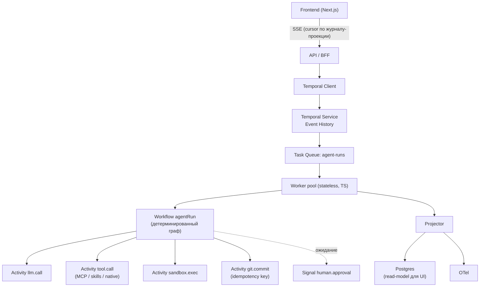
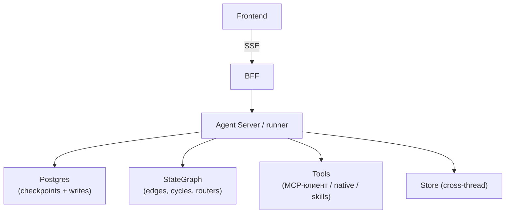
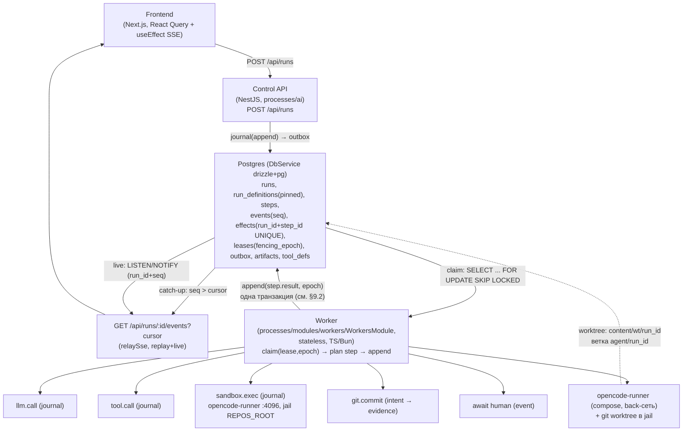
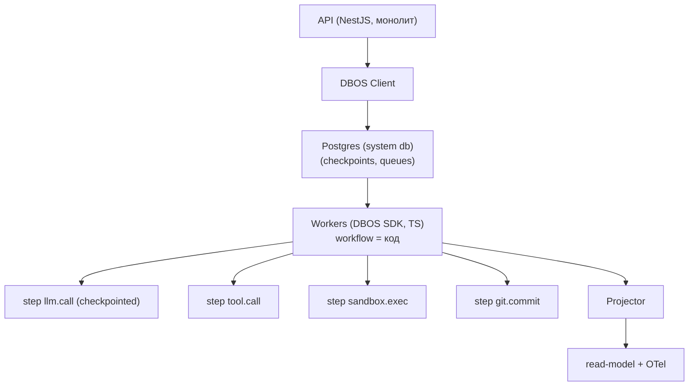
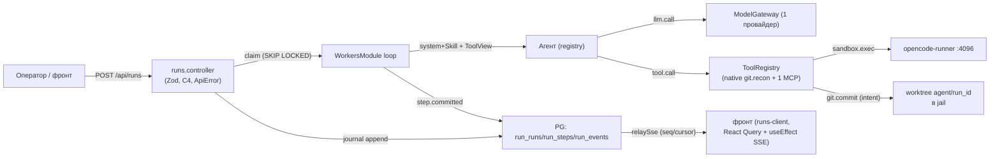

# ADR-0001. Облачный харнес для выполнения coding-задач ИИ-агентами

| Поле | Значение |
| --- | --- |
| Статус | Proposed (Rev.6 — фокус на прототип агентской системы, 2026-11-06) |
| Дата | 2026-11-04 (Rev.6 — 2026-11-06) |
| Автор | архитектурный ревью (режим проектирования) |
| Область | платформа: оркестрация агентов, инструменты (tools/skills/MCP), состояние, стриминг |
| Связанные артефакты | `docs/adr/` (этот ADR), канон репо (`AGENTS.md`, `DESIGN.md`, `apps/backend/{AGENTS.md,ARCHITECTURE.md,CODE_OF_CONDUCT.md}`, `apps/frontend/{AGENTS.md,DESIGN.md}`, `packages/contracts/AGENTS.md`), решения `docs/*` и контракты (`contracts/openapi.yaml`, `packages/contracts/src/`) — полный разбор в §16 |

Пометки в тексте: **[проверено]** — утверждение сверено с первоисточником (спецификация/документация/реестр пакетов), версия и дата указаны; **[предположение]** — вывод, не подтверждённый источником; **[не найдено]** — данных в ресёрче недостаточно.

---

## 1. Контекст

Нужен облачный харнес (runtime + control plane), в котором ИИ-агенты выполняют coding-задачи: читают репозиторий, вызывают инструменты, запускают команды, коммитят, отчитываются. Харнес должен работать как сервис: задачи живут в фоне, переживают падение воркера и рестарт деплоя, отдают прогресс во фронтенд, позволяют менять определения агентов и набор инструментов без остановки.

Исходные требования (из постановки) приняты как есть:

- **FR1** мультиагентная оркестрация: ветвление, циклы, условные переходы (conditional edges), классификаторы/роутеры.
- **FR2** единая абстракция инструментов: MCP-серверы, skills, нативные tools.
- **FR3** MCP по HTTP (Streamable HTTP), с проверкой совместимости с legacy HTTP+SSE.
- **FR4** фоновое выполнение, независимое от клиентской сессии.
- **FR5** журнал событий агентов: append-only, упорядоченный, пригодный для аудита.
- **FR6** возобновление прерванного воркера с последней согласованной точки.
- **FR7** стриминг состояния на фронтенд: подписка + переподключение с курсором.
- **FR8** hot-reload определений агентов, skills и конфигурации MCP без остановки системы.
- **NFR1** расширяемость без изменения ядра; **NFR2** горизонтальная масштабируемость воркеров; **NFR3** минимальный vendor lock-in, заменяемый провайдер инференса; **NFR4** наблюдаемость (трассировка, корреляция run/step/agent).
- **I1** воркеры stateless; **I2** два носителя состояния (БД-журнал + git-репозиторий); **I3** event-driven, журнал — источник истины для восстановления; **I4** стек TS/Node или Bun **[проверено: подтверждается репозиторием — bun 1.4.2, NestJS backend, Next.js frontend]**.
- **I5** Forward-Only: история `baseCommit` никогда не переписывается назад; допустим только рост вперёд (`revert`, новые коммиты), `reset --hard`/`push --force` запрещены.
- **I6** Модулит: один деплоящийся NestJS-монолит (`processes/ → organizations/ → common/`, `ARCHITECTURE.md`); новые границы — только NestJS-модули (`<parent>/modules/<sub>/`), отдельных микросервисов, service mesh и кросс-сервисных саг не создаём. Масштабирование — горизонтальные реплики одного бэкенда + внешний Postgres; opencode-runner — существующая compose-инфраструктура (`:4096`, back-сеть), а не новый микросервис.

Не-цели: обучение и хостинг моделей, UI-дизайн, реализация кода в этом документе, выделение микросервисов.

---

## 2. Метод и границы ресёрча

Использованы: официальные спецификации (MCP), официальная документация фреймворков (Temporal, DBOS, LangGraph, Mastra, Restate, Vercel AI SDK, OpenAI Agents SDK, Claude Agent SDK, E2B, Git), реестры пакетов npm/PyPI для фиксации версий и дат релиза. Обзорные сравнения и issue-трекеры использовались только как указатели; утверждения на них не опираются.

Ограничения ресёрча: не проводилось нагрузочное тестирование, не проверялись лицензии всех компонентов, не проверялись коммерческие условия managed-сервисов (LangSmith/LangGraph Platform, DBOS Conductor, Mastra Cloud, Inngest Cloud). Эти пункты вынесены в §13.

---

## 3. Состояние решений: что проверено

### 3.1. MCP: транспорт и совместимость (FR3)

Ключевое изменение, ломающее привычную модель: **редакция MCP `2026-07-28` сделала протокол stateless** **[проверено, modelcontextprotocol.io/specification/2026-07-28/changelog]**. Что именно изменилось:

| Механизм | 2025-03-26 … 2025-11-25 | 2026-07-28 |
| --- | --- | --- |
| Handshake | `initialize` + `notifications/initialized` | отсутствует; версия и capabilities в `_meta` каждого запроса |
| Сессия | `Mcp-Session-Id` | удалена; состояние — только через server-minted handles в аргументах инструмента |
| Отдельный GET-стрим | был | удалён; `subscriptions/listen` — единственный долгоживущий поток |
| Resumability | `Last-Event-ID`, id событий SSE | **удалена**; разорванный поток теряет запрос, клиент обязан переотправить его с новым id |
| Server→client requests | sampling/elicitation/roots как отдельные JSON-RPC запросы | MRTR: `InputRequiredResult` (`resultType: "input_required"`) + повтор исходного запроса с `inputResponses` |
| Фоновые задачи | `tasks/*` в ядре (эксперим.) | вынесены в расширение `io.modelcontextprotocol/tasks` (`tasks/get`, `tasks/update`, polling) |
| HTTP+SSE (2024-11-05) | deprecated с 2025-03-26 | **Deprecated** по формальной политике жизненного цикла; минимальное окно деприкации — 12 месяцев |
| Форс-совместимость | версия в заголовке `MCP-Protocol-Version` (с 2025-06-18) | обязательные `Mcp-Method`, `Mcp-Name`, `MCP-Protocol-Version`; сервер обязан валидировать соответствие заголовков телу (`HeaderMismatch`, `-32020`) |
| Roots/Sampling/Logging | активны | **Deprecated**; рекомендованные миграции: пути через аргументы инструмента, прямой вызов провайдера вместо Sampling, OpenTelemetry вместо Logging |

Практические следствия для нас:

1. **Совместимость с legacy обязательна на переходный период.** Спецификация задаёт «dual-era» модель: клиент пробует современный запрос, на `400 Bad Request` разбирает тело — распознанная современная ошибка (`UnsupportedProtocolVersionError`, `HeaderMismatch`, `MissingRequiredClientCapabilityError`) означает «сервер современный, надо повторить с поддерживаемой версией»; пустое/непонятное тело — фолбэк на `initialize`, затем на legacy HTTP+SSE (`GET` → `endpoint` event) **[проверено, streamable-http.md § Backward Compatibility]**.
2. **Ре-доставку MCP-сообщений строить нельзя.** Ре-sumability удалена на транспортном уровне; значит FR5/FR6 обязаны жить у нас, а не у MCP.
3. **Sampling как способ гонять LLM через MCP-сервер не использовать** — фича деприкуется **[проверено, changelog § Deprecated]**; провайдер инференса вызываем сами (это же требование NFR3).
4. Для длительных инструментов (сборка, тесты, длинный grep) правильный примитив — Tasks-расширение с polling (`tasks/get`), а не удержание SSE-потока **[проверено, changelog § Major 6]**.

Версия официального TS SDK: `@modelcontextprotocol/sdk` **1.32.2** (2026-10-23) **[проверено, registry.npmjs.org; поддержка редакции `2026-07-28` (stateless/MRTR/Tasks-расширение) по реестру не видна — проверить на пилоте, см. §13-п.5]**.

### 3.2. Durable execution

| Продукт | Модель | Версия / дата | Что даёт | Ограничение |
| --- | --- | --- | --- | --- |
| Temporal | отдельный сервер, Workflow/Activity, Event History | TS SDK `@temporalio/client` 1.25.0 (2026-10-27), Python `temporalio` 1.35.0 (2026-10-28) **[проверено]** | реплей по истории, таймеры, сигналы, версионирование, горизонтальное масштабирование воркеров, готовые интеграции (AI SDK, OpenAI Agents, Claude Agent SDK, LangGraph, Mastra, Strands) **[проверено, docs.temporal.io/ai]** | код Workflow должен быть детерминированным; вся недетерминированность (LLM, сеть, время) — в Activities; собственный сервер в эксплуатации |
| Restate | durable execution как библиотека + рантайм, virtual objects | `@restatedev/restate-sdk` 1.18.3 (2026-11-04), Python `restate-sdk` 1.3.0 (2026-11-04) **[проверено]** | `ctx.run()` вокруг LLM-вызова, durable sessions, pause/resume, journal на шаг, откаты **[проверено, docs.restate.dev/ai]** | свой рантайм; модель виртуальных объектов требует дисциплины ключей |
| DBOS | библиотека поверх Postgres, чекпоинт на шаг | `@dbos-inc/dbos-sdk` 5.4.0 (2026-10-28), Python `dbos` 3.4.0 (2026-10-28) **[проверено]** | без отдельного оркестратора; 1 запись в БД на шаг; восстановление с последнего завершённого шага; durable queues; версионирование/патчинг workflow **[проверено, dbos.dev/architecture]** | workflow-функция обязана быть детерминированной, шаги идемпотентными; в пределах одного приложения все воркеры — на одном языке (кросс-язык возможен между приложениями через Client/shared system DB) **[проверено, там же]**; для HA-восстановления в кластере рекомендуется managed control plane Conductor (SaaS, условия и лицензия enterprise-пакета не проверены — см. §13-п.2) |
| Inngest | событийные durable functions, step memoization | `inngest` 4.26.2 (2026-10-29) **[проверено]** | step-based retries, отмена, конкурентность, наблюдаемость | состояние и журнал — во внешнем сервисе; self-host вариант существует, но его паритет с облаком не проверен **[предположение]** → риск конфликта с I2/NFR3 |

Ориентир по производительности DBOS: ~1 000 workflow/шагов в секунду на vCPU Postgres, 20 000/с на 16 vCPU, шардирование до >1 млн/с **[проверено, dbos.dev/architecture]** — это на 3–4 порядка выше потребности харнеса coding-агентов (десятки одновременных run, шаги длиной в секунды-минуты) **[предположение]**.

### 3.3. Графовые фреймворки с checkpointer

**LangGraph** (PyPI `langgraph` 1.2.19, 2026-10-30 **[проверено]**):

- чекпоинт на каждый super-step + отдельные записи по узлам (pending writes) — при падении успешные узлы не перезапускаются **[проверено, checkpointers.md]**;
- режимы долговечности `exit` / `async` / `sync`: в `exit` промежуточное состояние не сохраняется и восстановление после краша невозможно **[проверено, там же]**;
- **важно:** replay с более раннего `checkpoint_id` **пере-исполняет узлы после чекпоинта, включая LLM-вызовы и API-запросы** **[проверено, checkpointers.md § Replay]** — это прямо конфликтует с требованием FR6 «не повторять side effects»;
- `PostgresSaver` — production-вариант; `DeltaChannel` (бета) требует `langgraph>=1.2` **[проверено]**;
- в JS/TS экосистеме LangGraph присутствует, но первичная документация и большая часть интеграций — Python **[предположение]**.

**Mastra** (`@mastra/core` 1.82.0, 2026-11-04 **[проверено]**):

- workflow = шаги + control flow, `suspend/resume`, streaming и `resumeStream`, перезапуск активных run с последнего активного шага **[проверено, mastra.ai/docs/workflows/overview]**;
- при исполнении держится **lease на run**, но он **advisory и не fencing-ит записи**: если процесс завис дольше TTL, шаг может выполниться повторно **[проверено, там же]** — для нас это прямой аргумент за собственный fencing-токен;
- встроенный движок по умолчанию, managed-исполнение — через workflow runners (Inngest и др.), есть интеграция с Temporal **[проверено]**.

### 3.4. Agent SDK

| SDK | Версия | Что даёт | Ограничение для харнеса |
| --- | --- | --- | --- |
| OpenAI Agents SDK (TS) | `@openai/agents` 0.21.0 (2026-10-20) **[проверено]** | агентский цикл, handoffs/agents-as-tools, guardrails, sessions, MCP-инструменты, sandbox agents (изолированная ФС + shell), tracing **[проверено, openai.github.io/openai-agents-js]** | долговечность/восстановление — не его ответственность; sandbox-сессии привязаны к вендору |
| Claude Agent SDK (TS) | `@anthropic-ai/claude-agent-sdk` 0.3.318 (2026-11-03), Python `claude-agent-sdk` 0.2.178 (2026-11-04) **[проверено]** | запускает **бинарник Claude Code как библиотеку**; даёт hooks, subagents, MCP, permissions, sessions, skills/commands/memory из `.claude/` **[проверено, code.claude.com/docs/en/agent-sdk/overview]** | это «чужой харнес внутри нашего»: процесс-обёртка, своя модель сессий и прав; встраивается как один из исполнителей, не как ядро |
| Vercel AI SDK | `ai` 7.0.162 (2026-11-03) **[проверено]** | провайдеро-независимый слой моделей, tool calling, UI-стриминг; resumable streams через `resumable-stream` 2.2.13 + Redis, `activeStreamId`, `GET /stream` → `204` если потока нет, `resumeStreamIsReplay` **[проверено, ai-sdk.dev resume-streams]** | resumability реализуется приложением (Redis + два эндпоинта), а не протоколом |
| Inngest AgentKit | (док. 2026) **[проверено, agentkit.inngest.com]** | сети агентов + router + state, MCP-инструменты, интеграции E2B/Daytona | привязка к Inngest как runtime |

### 3.5. Skills как формат

Спецификация Agent Skills (`agentskills.io`, версионирования нет — снято 2026-11-04) **[проверено]**: скилл — каталог с `SKILL.md` (YAML frontmatter: `name` ≤64, `description` ≤1024, опц. `license`, `compatibility`, `metadata`, экспериментальный `allowed-tools`), плюс опциональные `scripts/`, `references/`, `assets/`. Ключевой принцип — **progressive disclosure**: метаданные (~100 токенов) грузятся на старте для всех скиллов, тело `SKILL.md` (<5000 токенов рекомендовано, <500 строк) — при активации, файлы ресурсов — по требованию. Есть референс-валидатор `skills-ref validate`.

Это ровно то, что нужно для FR8 и NFR1: скилл — версионируемый артефакт в git, загрузка — по требованию, активация детерминирована описанием.

### 3.6. Изоляция исполнения (внутренний проект, Docker; полной изоляции ресурсов нет)

E2B (`e2b` 2.63.0, 2026-11-04 **[проверено]**) даёт изолированные Linux-микровиртуальные песочницы с pause-снапшотом памяти **[проверено, docs.e2b.dev]** — для данной версии **не применяем**: проект внутренний, приложение живёт в Docker-контейнерах из существующего compose-стека, per-run изоляции CPU/memory/cgroup и microVM не делаем. Исполнитель — compose-сервис `opencode` (registry-образ, лимиты `2G/2.0`, `expose: 4096` только в сеть `back`, volumes `opencode-projects/...`) + `OpencodeSdkClient` (lazy `@opencode-ai/sdk/v2`) + `fetchWithRetry` + `ApiError`-envelope **[проверено по `docker-compose.yml`, `ARCHITECTURE.md`, `apps/backend/AGENTS.md`]**.

Решение: **логическая изоляция вместо ресурсной** — `REPOS_ROOT`-jail (`WorkspacePathService.assertInsideJail`) + `1 run = 1 ветка + 1 worktree` + арендный claim-loop (§9.2) + C4-гейт. Квота = лимиты compose-сервисов + диск `opencode-projects` (общие на всех run, без per-run cgroup). E2B остаётся лишь именем будущего `SandboxProvider` и на решение не влияет (§9.5, §13-п.4). Resume покрывается журналом run + `sandbox_id`, а не снапшотом памяти.

### 3.7. Git как второй носитель состояния

`git worktree` **[проверено, git-scm.com/docs/git-worktree, 2.56.0]**: несколько рабочих деревьев на один репозиторий, общие `refs/*`, приватные `HEAD`/`index`; **одна ветка не может быть вычекнута в двух worktree** (add отказывает без `--force`); есть `--lock` против prune и `remove` только для чистого дерева. Прямое предупреждение в документации: «Multiple checkout in general is still experimental, and the support for submodules is incomplete» **[проверено]** — в нашем стеке это закрывается существующими модулями: `repository/{repos,workspaces,clone}` + pure-хелперы `utils/{repos-git,submodules}` (`ARCHITECTURE.md`); worktree V3 создаётся внутри jail (`REPOS_ROOT/.../projects/<id>/content/wt/<run_id>`, см. §9.4), сабмодули идут через `utils/submodules`, в MVP — флаг «без сабмодулей» тем же гейтом.

### 3.8. Наблюдаемость

GenAI-семантические конвенции OTel вынесены из основного репозитория в `open-telemetry/semantic-conventions-genai`; в README поле Schema URL помечено `TODO` **[проверено, GitHub README, 2026-11-04]**. Вывод: атрибуты `gen_ai.*` пока нестабильны, нужен собственный слой маппинга и версионирование дашбордов. В нашем стеке это ложится на `AppLogger` + `ExternalClient`-семантику (`service/operation/attempt/latencyMs/status/code`, без URL/body/секретов) и `x-correlation-id` из `ApiError`-envelope — корреляция `run/step/agent` едет теми же полями (см. §9.9).

### 3.9. Стек проекта (as-is, закрывает часть пробелов §13)

Ядро V3 ложится на существующий стек без новых инфраструктурных компонентов **[проверено по репозиторию, 2026-11-06]**:

- **Runtime/каркас:** `bun@1.4.2`, NestJS 12 (`@nestjs/* ^12`), TS, `zod ^4.6.5`, `drizzle-orm ^0.45.3` + `pg ^8.12.0`, `nx ^23.3.0`, `biome` через `packages/biome-config`. Проверки: `bun run lint` (`tsc --noEmit` + `biome lint`), `bun run build`, `bun run test` / `test:e2e`.
- **БД-доступ:** `apps/backend/src/common/db/DbService` (`drizzle(pool)`) — строгий Postgres, без memory-fallback: без `DATABASE_URL` пул `null`, любой вызов — 503 `EXTERNAL_UNAVAILABLE` через `dbUnavailable` (один лог `[db] unavailable`, `Retry-After: 30`). Миграции — code-first `schema.ts` + `drizzle/` (`drizzle-kit migrate` в проде), целостность — `db:check-integrity`. e2e — одноразовый `postgres:16-alpine` через testcontainers (`e2e-db.container.ts`), `scripts/e2e.ts` с бюджетом `E2E_SUITE_TIMEOUT_MS=300000`; `TEST_DATABASE_URL`/`E2E_DB_MODE=unreachable` — только явные override.
- **Модульная структура (куда ложится V3):** слои `processes/ → organizations/ (⊃ projects/) → common/` (`ARCHITECTURE.md`), стрелка только вниз; `common/` — один `@Global()` модуль без `*.module.ts` в подпапках; вложенность только `<parent>/modules/<sub>/`; утилиты `utils/<name>/index.ts` + `__tests__/`; `uuidv7` только `Bun.randomUUIDv7()`; DI — `private readonly`. Заготовка воркеров уже есть: `processes/modules/workers/WorkersModule` (scaffold, без контроллера) — дом для claim-loop V3. Доменная очередь — `organizations/modules/projects/.../sessions` (`project_sessions`) как образец.
- **Готовый задел журнала:** таблицы `project_sessions` / `session_messages` (domain id `text`, не uuid — покрывает и `ses_*`, и harness-uuid) / `session_agents` уже реализуют половину FR5: soft-delete (`deleted_at`, `RESTRICT` на FK), индексы `(session_id, created_at)`, scope `project_id` под C4-гейт. V3 добавляет рядом `run_*` таблицы в том же `schema.ts`, теми же конвенциями (см. §9.1–9.3), а не новую БД.
- **Готовый задел стриминга:** `GET /api/sessions/events` (`sessions.controller.ts:202`) через `common/sse/sse-relay.ts`: probe до заголовков → честный 503 (не 200-тишина), `AbortController` на downstream-close, `x-accel-buffering: no` + `x-correlation-id`, best-effort `return()` с гонкой 1500 мс. `session-harness.service.streamEvents` уже делает replay буфера + live-хвост с `LOCAL_IDLE_MS`/`STREAM_CAP_MS` и фильтром по scope проекта. §9.7 V3 — тот же `relaySse`, только источник — журнал run, а не шина opencode (см. §9.7).
- **Готовый задел исполнителя:** compose-сервис `opencode` (registry-образ, `2G/2.0`, `expose: 4096` только в сеть `back`, volumes `opencode-projects/ssh-keys/gh-config/pnpm-store/data/secrets/playwright-browsers`), бэкенд-доступ — `OpencodeSdkClient` (lazy `@opencode-ai/sdk/v2`, в `package.json` `@opencode-ai/sdk 1.18.33`) + сырой `fetchWithRetry` + `serveBasicAuthHeader`, ошибки — `EXTERNAL_*` → `ApiError`-envelope. Поэтому первичный исполнитель V3 — **существующий opencode-runner**, а не новый E2B-флот (E2B понижен до будущего `SandboxProvider`, см. §9.5). Отдельного кластера (Temporal/Restate/DBOS-runtime) не вводится — закрывает пробел лицензий §13-п.2: новых runtime-зависимостей у V3 нет.
- **Контракты и фронт:** `@rush-code/contracts` — типы + `zod v4` boundary-схемы, зеркало `contracts/openapi.yaml` поле-в-поле (расхождение = баг). Фронт: Next.js 16.3 Turbopack, React Query (`useQuery`/`useMutation`, ключи только из `query-keys.ts`), единственный fetch-слой `src/api/client.ts` (`NEXT_PUBLIC_API_URL` verbatim, `ApiClientError`, `x-correlation-id`, парсинг boundary-схемами), SSE — документированное исключение (`streamSessionEvents`, `useEffect`, финал `session.step.ended`, `stop()` глушит кадры). V3 переиспользует этот контракт: новые кадры run — расширение `SessionStreamFrame`, а не второй транспорт (см. §9.7).
- **Storage/jail:** `REPOS_ROOT` — единственный корень (`(users|orgs)/<scope>/projects/<id>/content`), fs только через `WorkspacePathService` (`assertInsideJail`), без корня — 503/500 (не `<cwd>/repos`). Git-поверхность уже модульна: `repository/{repos,workspaces,clone}` + pure-хелперы `utils/{repos-git,submodules}`. Worktree-стратегия V3 строится поверх них (см. §9.4), поведение на сетевых ФС — тот же jail + лок-правила, отдельного исследования не требует (закрывает §13-п.7 как «решено архитектурой»).
- **Логи/границы:** только `AppLogger` (normal path — однострочники без стеков/секретов, стек только в `debug` через `serializeCause`; `ExternalClient` — `service/operation/attempt/latencyMs/status/code`), `console.*` запрещён, e2e-скан секретов обязателен. `JwtAuthGuard` + `ProjectAccessService` (C4: stranger → 404 без утечки). Фронт-гейт `no-opencode-transport`: `@opencode-ai/sdk` и `/api/opencode/*` запрещены в `src+app` — V3 ходит только через доменные `/api/sessions*` и новый `/api/runs*`.

GenAI-семантические конвенции OTel вынесены из основного репозитория в `open-telemetry/semantic-conventions-genai`; в README поле Schema URL помечено `TODO` **[проверено, GitHub README, 2026-11-04]**. Вывод: атрибуты `gen_ai.*` пока нестабильны, нужен собственный слой маппинга и версионирование дашбордов.

---

## 4. Ключевые находки, определяющие решение

1. **MCP больше не даёт ни сессий, ни ре-доставки** → FR5/FR6/FR7 целиком наша ответственность. Зато statelessness упрощает горизонтальное масштабирование: любой воркер может обслужить любой вызов без привязки к сессии.
2. **Ни один готовый фреймворк не даёт одновременно из коробки без существенного дополнительного слоя** (а) граф с циклами и роутерами, (б) журнал как источник истины, (в) resume без повтора side effects, (г) версионирование определений. Temporal ближе всех по (б) и (в), но требует детерминированного кода; LangGraph даёт (а), но по документации **пере-исполняет LLM-вызовы при replay**; DBOS даёт (б)(в) и не пере-исполняет шаги, но модель графа — обычный код, и стриминга нет.
3. **`step` — правильная единица долговечности**, а `run` — единица изоляции (worktree + sandbox). LLM-вызов, вызов инструмента, commit, approval — это шаги с разными типами эффектов.
4. **Единственная вещь, которую нельзя восстановить реплеем, — внешние эффекты** (git push, коммит, вызов чужого API, отправка сообщения). Их надо журналировать как «намерение → результат», а не как «код, который надо повторить».
5. **Стриминг не должен зависеть от транспорта инструментов**: MCP-потоки не ре-суммируемы, а фронтенду нужен курсор — значит стримим из нашего журнала, а не проксируем MCP.

---

## 5. Критерии и веса

Шкала весов: 1–10, вес отражает критичность для постановки (не путать со шкалой оценок 0–3 из §6). Добавлен критерий TCO (стоимость владения и time-to-first-run) — без него сравнение смещено в пользу «написать всё самим».

| # | Критерий | Вес |
| --- | --- | --- |
| FR1 | Оркестрация: ветвления, циклы, роутеры | 10 |
| FR2 | Единая абстракция tools/skills/MCP | 8 |
| FR3 | MCP Streamable HTTP + dual-era | 6 |
| FR4 | Фоновое исполнение | 9 |
| FR5 | Append-only журнал, аудит | 10 |
| FR6 | Resume без повтора side effects | 10 |
| FR7 | Стриминг + курсор + ре-доставка | 6 |
| FR8 | Hot-reload определений | 7 |
| NFR1 | Расширяемость без правки ядра | 8 |
| NFR2 | Горизонтальная масштабируемость | 7 |
| NFR3 | Vendor lock-in | 8 |
| NFR4 | Наблюдаемость run/step/agent | 7 |
| I1 | Stateless воркеры | 8 |
| I2 | Два носителя состояния (БД+git) | 7 |
| I3 | Event-driven, журнал = истина | 9 |
| I4 | TS/Node/Bun | 3 |
| TCO | Стоимость владения, time-to-first-run | 9 |
| | **Σ весов** | **132** (max 396) |

---

## 6. Матрица «кандидат × критерий»

Оценки 0–3 (3 — закрывает требование нативно, 2 — закрывает с доработкой, 1 — сопротивление, 0 — не закрывает). Кандидат G (Restate) добавлен при ревью Rev.1, чтобы закрыть пробел покрытия из §3.2: journal-based durable execution (`ctx.run`), durable sessions, свой рантайм; оценки: как DBOS по FR4/FR6/NFR2/I1/I3, но TCO=2 (свой рантайм в эксплуатации) и FR7=2 (стриминг — своим слоем).

| Критерий | A Temporal | B LangGraph | C Своё ядро (PG) | D DBOS | E Mastra | F Inngest+AgentKit | G Restate |
| --- | --- | --- | --- | --- | --- | --- | --- |
| FR1 | 3 | 3 | 3 | 2 | 3 | 3 | 3 |
| FR2 | 2 | 2 | 3 | 2 | 2 | 2 | 2 |
| FR3 | 2 | 2 | 3 | 2 | 2 | 2 | 2 |
| FR4 | 3 | 2 | 3 | 3 | 2 | 3 | 3 |
| FR5 | 3 | 2 | 3 | 3 | 2 | 2 | 3 |
| FR6 | 3 | 3 | 3 | 3 | 2 | 3 | 3 |
| FR7 | 2 | 2 | 3 | 1 | 3 | 2 | 2 |
| FR8 | 2 | 2 | 3 | 2 | 2 | 2 | 2 |
| NFR1 | 2 | 3 | 3 | 2 | 3 | 2 | 2 |
| NFR2 | 3 | 2 | 3 | 3 | 2 | 3 | 3 |
| NFR3 | 2 | 2 | 3 | 2 | 2 | 1 | 2 |
| NFR4 | 3 | 2 | 2 | 2 | 2 | 2 | 2 |
| I1 | 3 | 3 | 3 | 3 | 3 | 3 | 3 |
| I2 | 2 | 2 | 3 | 2 | 2 | 1 | 2 |
| I3 | 3 | 2 | 3 | 2 | 2 | 3 | 3 |
| I4 | 3 | 2 | 3 | 3 | 3 | 3 | 3 |
| TCO | 1 | 2 | 1 | 3 | 2 | 3 | 2 |
| **Взвешенный балл** | **328 / 396 (82.8 %)** | **300 (75.8 %)** | **371 (93.7 %)** | **314 (79.3 %)** | **299 (75.5 %)** | **314 (79.3 %)** | **330 / 396 (83.3 %)** |

Методологическая оговорка (обязательна к прочтению вместе с решением §10): вариант C описан в требованиях и потому получает `3` там, где остальным ставится `2` «с доработкой», хотя доведение остальных до FR — тот же класс работ, что написание ядра C. Ранжирование A/D/F/G неустойчиво: сдвиг любой одной оценки на ±1 меняет порядок (A=328, G=330, D=F=314). Проверено два сценария чувствительности: при весе TCO=20 (Σ=143, max=429) C=382 (89.0 %), G=352 (82.1 %), D≈347 (80.9 %), A=339 (79.0 %); при снижении всех `3` варианта C до `2` по спорным FR2/FR3/FR8/NFR1 (аргумент «этого кода ещё нет») C теряет 8+6+7+8=29 баллов → 342 (86.4 %) и оказывается вровень с G/A. Поэтому матрица — не доказательство превосходства C, а структурированная опора для §10–§12; решение держится на качественных аргументах (журнал как истина, stateless MCP), а не на отрыве в процентах.

---

## 7. Варианты архитектуры

### V1. Temporal-центричный (отклонён: нарушает I6 — отдельный кластер)



Плюсы: восстановление и журнал — готовые и проверенные; таймеры/сигналы/аппрувы из коробки; масштабирование воркеров по task queue; большое число готовых интеграций с агентскими SDK **[проверено, docs.temporal.io/ai]**.

Минусы: жёсткая дисциплина детерминизма (любой `Date.now()`, `random`, прямой HTTP в workflow-коде ломает реплей); payload-лимиты требуют внешнего хранилища для транскриптов и больших tool-результатов: один аргумент/результат Activity — до 2 МБ, суммарное gRPC-сообщение — до 4 МБ, всё пишется в Event History **[проверено, docs.temporal.io/develop/typescript/activities/basics]**; эксплуатация отдельного кластера; версионирование определений агентов = версионирование воркеров/деплой, «живого» reload нет.

Риски: дрейф недетерминизма в workflow-коде проявляется только на реплее; сложность обучения команды. TCO: высокий (кластер + экспертиза).

### V2. LangGraph-центричный (отклонён: replay пере-исполняет LLM; Agent Server — отдельный сервис, против I6)



Плюсы: лучшая в классе выразительность графа; чекпоинты на super-step с pending writes; зрелые PG-чекпоинтеры.

Минусы: чекпоинт — снимок состояния, а не журнал эффектов; replay пере-исполняет LLM-вызовы (документировано) → FR6 выполняется только ценой идемпотентных/дешёвых повторов; горизонтальное масштабирование и фоновость — на нас; production-обвязка (Agent Server) тянет к платформе LangSmith → NFR3; TS-путь вторичен.

Риски: «повторный LLM-вызов» = деньги и невоспроизводимый аудит. TCO: средний, но с платформенной зависимостью.

### V3. Собственное event-sourced ядро на Postgres (рекомендуемый; модулит — по `ARCHITECTURE.md`)



Ретранслятор outbox→очередь — тонкий провайдер внутри `WorkersModule` (без нового компонента: claim через `SKIP LOCKED`; `graphile-worker`/`bullmq` из источника №32 — только запасные варианты, если понадобится персистентная очередь вне PG).

Ядро маленькое и специфичное: типов шагов ~6, типов эффектов ~8; таблицы — рядом с `project_sessions`/`session_messages` в том же `common/db/schema.ts` (те же конвенции: soft-delete, `RESTRICT`, индексы, `project_id` как scope C4-гейта). Всё остальное (агенты — `processes/modules/ai/modules/agents`, инструменты, скиллы, MCP-серверы) — данные (`definitions`, `tool_defs`), а не код; scope-правило `processes → organizations → common` не нарушается (ядро не импортирует домены, домены регистрируют пробы/эффекты сами).

Плюсы: полный контроль над семантикой resume (никакого детерминизма кода — восстанавливаемся по журналу, а не реплеем); журнал append-only по определению; hot-reload = новая версия определения в таблице, run пиннит версию; один store (Postgres) + git; минимальный vendor lock-in (зависимости: Postgres, git, sandbox-API); TCO падает после MVP, но требует владельца ядра.

Минусы: пишем планировщик, аренды, ретраи, версионирование схемы событий; риск «изобретаем Temporal»; наблюдаемость строим сами (OTel).

Риски: незрелость ядра — главный. Митигация: конечный набор типов шагов, контрактные тесты на durable-инварианты, лимит на сложность (см. §12).

### V4. DBOS-центричный («buy» как библиотека внутри монолита, не как сервис)



Плюсы: durable execution без оркестратора; шаги после чекпоинта не пере-исполняются **[проверено]**; durable queues с конкурентностью и rate-limit; TS-первый; версионирование/патчинг предусмотрены.

Минусы: нет графа как первоклассной сущности (циклы и роутеры — обычный код, это нормально, но визуализация/аудит переходов слабее); стриминга нет — свой слой; HA-восстановление в кластере опирается на managed control plane Conductor (SaaS; см. ограничение выше) → частичный lock-in.

### Прочие (не доведены до полного варианта)

Mastra + Inngest runner: быстрый старт, хороший стриминг, но advisory lease без fencing и состояние во внешнем сервисе. Inngest + AgentKit: лучший DX для step-memoization, но журнал и состояние вне нашей БД → нарушает I2.

---

## 8. Плоскость инструментов: как подключаются tools, skills и MCP

Это ответ на FR2/FR3/FR8 в отрыве от выбора движка.

### 8.1. Единый дескриптор

Все источники приводятся к одному `ToolDescriptor`:

```
ToolDescriptor {
  id:            string            // "mcp:github/create_issue", "skill:branch-work", "native:git.recon"
  title, description
  inputSchema:   JSONSchema 2020-12
  outputSchema?: JSONSchema 2020-12
  source:        "mcp" | "skill" | "native"
  transport?:    { kind: "streamable-http", endpoint, protocolVersion, era: "modern"|"legacy"|"dual" }
  effects:       { class: "read" | "write-local" | "write-external", idempotent: bool, compensable: bool }
  limits:        { timeoutMs, maxBytes, concurrency }
  auth:          { mode: "none" | "oauth" | "broker-token", scopes[] }
  version:       string            // semver/hash дескриптора, пиннится в run
}
```

Правило: **политика (эффекты, лимиты, auth) живёт в дескрипторе, а не в промпте агента**. Агент (и модель) видит только проекцию `ToolView = {id, title, description, inputSchema, outputSchema?}`; полные `effects/limits/auth/transport/version` видит только оркестратор. Передача полного `ToolDescriptor` в модель запрещена (см. §9.8).

### 8.2. Резолвинг и порядок

1. На старте run фиксируется `definitionVersion` = (agent defs hash, tool registry hash, MCP config hash).
2. `ToolRegistry` собирает дескрипторы из трёх адаптеров: MCP-клиент (`tools/list` + `server/discover`), skills-лоадер (frontmatter всех `SKILL.md` — только метаданные, тело по активации), native-реестр (in-process функции).
3. Коллизии имён не мержатся: префикс источника обязателен (`mcp:`, `skill:`, `native:`).
4. Cacheability: у MCP 2026-07-28 результаты списков несут `ttlMs` и `cacheScope` **[проверено, changelog § Minor 5]** — используем их как TTL кэша дескрипторов вместо polling.

### 8.3. MCP-клиент: обязательные свойства

- `server/discover` перед первым использованием; кэш эры сервера на origin/процесс **[проверено, versioning.md]**.
- Dual-era: современный запрос → разбор `400` → `initialize`-фолбэк → HTTP+SSE-фолбэк **[проверено]**.
- Заголовки: `MCP-Protocol-Version`, `Mcp-Method`, `Mcp-Name`, `Mcp-Param-*` при `x-mcp-header`. Корректность заголовков относительно тела — обязанность клиента (нас) при отправке; проверка соответствия — обязанность сервера (`HeaderMismatch`, `-32020`); промежуточные прокси обязаны возвращать ошибку, а не молча маршрутизировать по непроверенным заголовкам **[проверено, streamable-http.md § Server Validation]**.
- Долгие инструменты: Tasks-расширение (`tasks/get`, `tasks/update`), а не удержание потока **[проверено]**.
- Каждый `tools/call` — шаг с журналом: `request_hash`, `response_hash`, `attempt`, `durationMs`, `bytesIn/Out`. Разрыв SSE = потерян запрос → переотправка с новым id **и** проверкой по `request_hash` в журнале, чтобы не выполнить дважды.

### 8.4. Skills

- Раскладка по спеке: `skills/<name>/SKILL.md` + `scripts/`, `references/`, `assets/` в git-репозитории платформы **[проверено]**.
- Загрузка трёхступенчатая (метаданные → тело → ресурсы) **[проверено]**; индексация метаданных в `tool_defs` для поиска.
- `allowed-tools` — экспериментальное поле **[проверено]**, поэтому enforcement делаем сами: скилл объявляет белый список tool-id, ядро проверяет его перед вызовом.
- Валидация при публикации: `skills-ref validate` в CI **[проверено]**.
- Скилл — не «инструмент», а поставщик инструкций + скриптов. Эффект скилла НЕ фиксирован как `read`: базовый класс наследуется от вызываемых артефактов — чистые инструкции/шаблоны = `read`, `scripts/*` с записью на диск/в сеть/в git = минимум `write-local` (переоценка вверх обязательна, вниз — запрещена). Классификация `read/idempotent=true` допустима только для скиллов без исполняемых скриптов.

### 8.5. Native tools и sandbox-инструменты

Нативные инструменты (git-разведка, запуск проверок, работа с worktree) — in-process, но с обязательной классификацией эффекта. Всё, что пишет на диск/в git/наружу, идёт через **effect broker** (см. §9.2), а не напрямую из «мозга» агента.

### 8.6. Аутентификация

- MCP: OAuth по спецификации; DCR (RFC 7591) деприкуется в пользу Client ID Metadata Documents, клиенты обязаны проверять `iss` (RFC 9207) **[проверено, changelog § Deprecated/Minor]** — планируем поддержку CIMD, DCR оставляем только для legacy-серверов.
- Для инструментов, которым нужен git/облако: **не** прокидывать долгоживущий PAT в песочницу; выдавать short-lived scoped token через broker на конкретный шаг (см. §9.5).

### 8.7. Контракты V3 (конкретика — что именно добавляется в стек)

Правило зеркалирования (как у sessions): `contracts/openapi.yaml components/schemas` — источник правды; `packages/contracts/src/runs/{runs.ts,runs.schema.ts}` — зеркало поле-в-поле (`export type`, без `interface`; boundary — `zod v4`, Standard Schema). Расхождение YAML ↔ пакет = баг пакета. Бэкенд валидирует вход `ZodValidationPipe`, фронт парсит ответы теми же схемами через единый `src/api/client.ts`. Ошибки — замороженный `ApiError {code, message, correlationId}` + `x-correlation-id`; БД недоступна → 503 `EXTERNAL_UNAVAILABLE` + `Retry-After: 30` (через `dbUnavailable`, без memory-fallback).

#### 8.7.1. Таблицы (дополнение `apps/backend/src/common/db/schema.ts`, те же конвенции)

```ts
// runs — реестр run (мягкое удаление, история не стирается)
export const runRuns = pgTable("run_runs", {
  id: uuid("id").primaryKey().defaultRandom(),          // run_id; в app — Bun.randomUUIDv7()
  projectId: uuid("project_id").notNull()
    .references(() => projects.id, { onDelete: "restrict" }), // C4-scope, RESTRICT как у chats/sessions
  title: text("title"),
  status: text("status").notNull().default("open"),     // §8.7.5, CHECK в SQL
  definitionSetHash: text("definition_set_hash").notNull(),
  baseCommit: text("base_commit").notNull(),            // I5, run.started
  branch: text("branch").notNull(),                     // agent/<run_id>
  worktree: text("worktree").notNull(),                  // REPOS_ROOT/.../content/wt/<run_id>
  sandboxId: text("sandbox_id"),                         // opencode-runner слот; E2B — будущее
  agentId: text("agent_id"),                             // registry id, nullable как у sessions
  model: jsonb("model"),                                 // SessionInfoModel | null
  createdAt: timestamp("created_at", { withTimezone: true }).defaultNow().notNull(),
  updatedAt: timestamp("updated_at", { withTimezone: true }).defaultNow().notNull(),
  deletedAt: timestamp("deleted_at", { withTimezone: true }), // soft-delete, чтение — isNull(deletedAt)
}, (t) => [
  index("run_runs_project_idx").on(t.projectId),
  index("run_runs_project_status_idx").on(t.projectId, t.status),
]);

// steps — шаги run (write-ahead result, §9.1)
export const runSteps = pgTable("run_steps", {
  id: uuid("id").primaryKey().defaultRandom(),           // step_id
  runId: uuid("run_id").notNull()
    .references(() => runRuns.id, { onDelete: "restrict" }),
  seq: bigint("seq", { mode: "number" }).notNull(),      // монотонный per-run
  type: text("type").notNull(),                          // llm.call | tool.call | sandbox.exec | git.commit | await_human | router
  status: text("status").notNull().default("pending"),   // §8.7.5
  attempt: integer("attempt").notNull().default(0),
  inputHash: text("input_hash").notNull(),
  idempotencyKey: text("idempotency_key").notNull().unique(), // hash(run_id, step_id, effect_class, input_hash)
  observedEpoch: integer("observed_epoch").notNull().default(0), // fencing, §9.2
  resultRef: jsonb("result_ref"),                        // {artifact_ref, hash} | null до committed
  error: jsonb("error"),                                 // {code, message-sanitized} | null
  startedAt: timestamp("started_at", { withTimezone: true }),
  endedAt: timestamp("ended_at", { withTimezone: true }),
}, (t) => [
  uniqueIndex("run_steps_run_seq_idx").on(t.runId, t.seq),
  index("run_steps_run_status_idx").on(t.runId, t.status),
]);

// events — append-only журнал (источник истины, §9.1; UPDATE/DELETE запрещены политикой)
export const runEvents = pgTable("run_events", {
  id: uuid("id").primaryKey().defaultRandom(),
  runId: uuid("run_id").notNull()
    .references(() => runRuns.id, { onDelete: "restrict" }),
  seq: bigint("seq", { mode: "number" }).notNull(),      // id SSE-кадра, per-run
  type: text("type").notNull(),                          // §8.7.3
  data: jsonb("data").notNull(),
  prevHash: text("prev_hash").notNull(),                 // tamper-evident цепочка, §9.9
  createdAt: timestamp("created_at", { withTimezone: true }).defaultNow().notNull(),
}, (t) => [
  uniqueIndex("run_events_run_seq_idx").on(t.runId, t.seq),
]);

// effects — intent→confirm для внешних эффектов (§9.3); git — трейлер как identity
export const runEffects = pgTable("run_effects", {
  id: uuid("id").primaryKey().defaultRandom(),
  runId: uuid("run_id").notNull()
    .references(() => runRuns.id, { onDelete: "restrict" }),
  stepId: uuid("step_id").notNull()
    .references(() => runSteps.id, { onDelete: "restrict" }),
  class: text("class").notNull(),                        // read | write-local | write-external
  status: text("status").notNull().default("intent"),    // intent → committed | failed; committed → superseded
  trailerRunId: text("trailer_run_id").notNull(),        // Run-Id (первичный ключ идемпотентности)
  trailerStepId: text("trailer_step_id").notNull(),      // Step-Id
  observations: jsonb("observations").notNull().default([]), // [{sha}] — sha лишь наблюдения
  payload: jsonb("payload").notNull(),
}, (t) => [
  uniqueIndex("run_effects_run_step_idx").on(t.runId, t.stepId),
  index("run_effects_trailer_idx").on(t.trailerRunId, t.trailerStepId),
]);

// leases — аренда run (эфемерно, без soft-delete; fencing §9.2)
export const runLeases = pgTable("run_leases", {
  runId: uuid("run_id").primaryKey()
    .references(() => runRuns.id, { onDelete: "cascade" }),
  holder: text("holder").notNull(),
  expiresAt: timestamp("expires_at", { withTimezone: true }).notNull(),
  epoch: integer("epoch").notNull().default(0),
});

// definitions — версионированные определения (§9.6); tool_defs — индекс дескрипторов (§8.1)
export const runDefinitions = pgTable("run_definitions", {
  id: uuid("id").primaryKey().defaultRandom(),
  kind: text("kind").notNull(),                          // agent | skill | tool-registry | mcp-config
  name: text("name").notNull(),
  version: text("version").notNull(),
  hash: text("hash").notNull(),
  contentRef: text("content_ref").notNull(),             // commit_sha | blob-ref
  active: boolean("active").notNull().default(false),
  createdAt: timestamp("created_at", { withTimezone: true }).defaultNow().notNull(),
}, (t) => [
  uniqueIndex("run_definitions_kind_name_version_idx").on(t.kind, t.name, t.version),
  index("run_definitions_active_idx").on(t.active),
]);
```

`export type RunRow / RunStepRow / RunEventRow / RunEffectRow / ... = typeof x.$inferSelect;` — рядом с существующими `*Row`-типами. Миграции — `drizzle-kit` в `drizzle/`, целостность — `db:check-integrity`; e2e — testcontainers `postgres:16-alpine` по образцу auth/projects/keys.

#### 8.7.2. REST (`/api/runs*`, рядом с `/api/sessions*`, `VERSION_NEUTRAL`)

| Метод/путь | Вход (zod, строго) | Успех | Ошибки (ApiError, без утечек) |
| --- | --- | --- | --- |
| `POST /api/runs` | `CreateRunRequest {projectId: uuid, title?: 1..200, agentId?: agentId(1..64, ^[A-Za-z0-9][A-Za-z0-9_-]*$), model?: SessionInfoModel, definitionSetHash?: string}` | 201 `RunInfo` | 400 `bad_request`/`PROJECT_REQUIRED`; 404 `not_found` (C4, чужой проект); 503 `EXTERNAL_UNAVAILABLE` (БД/раннер down, `Retry-After: 30`) |
| `GET /api/runs?projectId=` | `projectId: uuid` (query, обязателен) | 200 `RunInfoList` | 400/404 как выше |
| `GET /api/runs/:id` | — | 200 `RunInfo` | 404 `not_found`; 503 как выше |
| `POST /api/runs/:id/interrupt` | `{projectId: uuid}` (best-effort; `interrupted:false` = idle no-op, не ошибка — как у sessions) | 200 `{interrupted: boolean}` | 400/404/503 как выше |
| `POST /api/runs/:id/upgrade-definition` | `{projectId: uuid}` | 200 `RunInfo` (новый `definitionSetHash`) + событие `run.definition.upgraded` | 400/404/503; 409 `conflict` если run терминален |
| `GET /api/runs/:id/events?cursor=` | `cursor?: int ≥ 0` (default 0) | 200 `text/event-stream` кадров `RunStreamFrame` (§8.7.3) | до заголовков — JSON-ошибки как выше (probe-down → честный 503, см. `relaySse`); после заголовков — только close |

```ts
// packages/contracts/src/runs/runs.ts (export type only)
export type RunStatus = "open" | "running" | "awaiting_human" | "failed" | "merged" | "abandoned";
export type RunStepStatus = "pending" | "running" | "committed" | "failed" | "skipped";
export type RunStepType = "llm.call" | "tool.call" | "sandbox.exec" | "git.commit" | "await_human" | "router";
export type RunInfo = {
  id: string;                       // uuidv7 (Bun.randomUUIDv7)
  projectId: string;                // uuid (C4-scope)
  title: string | null;
  status: RunStatus;
  definitionSetHash: string;        // пин §9.6
  baseCommit: string;                // I5, sha
  branch: string;                   // agent/<run_id>
  agentId: string | null;           // registry id
  model: SessionInfoModel | null;   // reuse из sessions (never duplicate)
  createdAt: string;                // ISO-8601 Z
  updatedAt: string;
};
export type RunInfoList = Array<RunInfo>;
export type CreateRunRequest = {
  projectId: string;
  title?: string;
  agentId?: string;
  model?: SessionInfoModel;
  definitionSetHash?: string;       // default: active-набор
};
```

Схемы `runs.schema.ts`: `runStatusSchema` (enum, frozen — новые значения только через ADR), `runInfoSchema` (`id/projectId` — `z.uuid()`, `createdAt/updatedAt` — `z.iso.datetime()`, `title/agentId/model` — explicit nullable, never optional), `createRunRequestSchema` (verbatim-валидация контроллера, тексты ошибок как у sessions), списки — `z.array(...)`.

#### 8.7.3. SSE-кадры (расширение `SessionStreamFrame`, новых транспортов нет)

```ts
export type RunStreamFrameType =
  | "run.started" | "run.step.started" | "run.step.committed" | "run.step.failed"
  | "run.definition.upgraded" | "run.interrupted" | "run.merged" | "run.abandoned"
  | "secret.issued" | "secret.revoked";
export type RunStreamFrame = {
  id: string;                       // seq как строка (монотонный per-run)
  type: RunStreamFrameType;         // строковый enum, заморожен; новое значение = новая схема + openapi
  data: Record<string, unknown>;     // payload варианта; крупные тела — только {artifact_ref, hash}
  run?: string;                     // hoisted run id (аналог session в SessionStreamFrame)
};
```

Правила (как у `session-harness.service.streamEvents`): catch-up `seq > cursor` из PG → live-хвост; кадры без `run` дропаются; фильтр — только run gated-проекта (снимок id один раз + `run.started` добавляет); текст/токены/секреты в кадры не кладутся (только факты + ссылки); `stop()`-семантика — как у `useChat` (abort downstream + partial-commit + drop кадров, `sendingRef`-гард — см. фронт).

#### 8.7.4. Инструменты (zod-фиксация §8.1)

```ts
export const toolIdSchema = z.string().min(1).max(200)
  .regex(/^(mcp|skill|native):[a-z0-9/_-]+$/, { error: 'Field "id" must be prefixed (mcp|skill|native)' });
export const toolDescriptorSchema = z.object({
  id: toolIdSchema,
  title: z.string().min(1).max(200),
  description: z.string().min(1).max(2000),
  inputSchema: z.record(z.string(), z.unknown()),   // JSON Schema 2020-12, object-корень
  outputSchema: z.record(z.string(), z.unknown()).optional(),
  source: z.enum(["mcp", "skill", "native"]),
  transport: z.object({
    kind: z.literal("streamable-http"),
    endpoint: z.url(),
    protocolVersion: z.string().min(1),
    era: z.enum(["modern", "legacy", "dual"]),
  }).optional(),
  effects: z.object({
    class: z.enum(["read", "write-local", "write-external"]),
    idempotent: z.boolean(),
    compensable: z.boolean(),
  }),
  limits: z.object({
    timeoutMs: z.number().int().min(1).max(300000),
    maxBytes: z.number().int().min(1).max(8 * 1024 * 1024),
    concurrency: z.number().int().min(1).max(8),
  }),
  auth: z.object({ mode: z.enum(["none", "oauth", "broker-token"]), scopes: z.array(z.string()) }),
  version: z.string().min(1),                        // semver/hash, пиннится в run
});
export const toolViewSchema = toolDescriptorSchema
  .pick({ id: true, title: true, description: true, inputSchema: true, outputSchema: true });
```

`ToolView` — единственное, что уходит в модель (§9.8); обрезка — на сервере (доверять клиенту обрезку запрещено). Коллизии — префиксом источника (§8.2); `ttlMs/cacheScope` MCP — TTL кэша `tool_defs`.

#### 8.7.5. Машины состояний (переходы только с событием)

- run: `open → running → (awaiting_human ⇄ running)* → merged | abandoned`; `failed` из `running/awaiting_human`. Терминальные (`merged/abandoned/failed`) — без выходов; `upgrade-definition` запрещён в терминальных (409).
- step: `pending → running → committed | failed | skipped`; `running → pending` — только через fencing-reclaim (§9.1, `attempt+1`).
- effect: `intent → committed | failed`; `committed → superseded` — только по правилу rebase §9.3.
- lease: `epoch` только растёт; запись с чужим/протухшим `epoch` → `fenced` + обязательный останов воркера (§9.2).

#### 8.7.6. Раскладка по репозиторию (модулит, CoC v2)

```
packages/contracts/src/runs/{runs.ts,runs.schema.ts,index.ts}  # + Run*-схемы в openapi.yaml components/schemas + paths /api/runs*
apps/backend/src/common/db/schema.ts                           # таблицы run_* выше + *Row-типы
apps/backend/src/processes/modules/runs/                       # runs.module/controller/service/dto (entities: две сущности — runs, runs/:id/events)
apps/backend/src/processes/modules/workers/                    # claim-loop, leases/outbox, reconciliation-job
apps/frontend/src/api/runs-client.ts                           # фасад поверх client.ts (как sessions-client.ts)
apps/frontend/src/hooks/ + query-keys.ts                       # useRuns/useRun/useRunEvents (React Query; SSE — useEffect-исключение с комментом)
apps/backend/.../__tests__/runs.e2e.ts                         # e2e на testcontainers (образец sessions.e2e.ts)
```

---

## 9. Детальные решения по обязательным вопросам

### 9.1. Семантика возобновления: replay или re-execute

**Решение: журнал результатов (effect log), а не реплей кода.**

Три режима, встречающиеся в индустрии:

| Режим | Пример | Что происходит при resume | Годится? |
| --- | --- | --- | --- |
| Полный реплей с пере-исполнением | LangGraph replay **[проверено]** | узлы после чекпоинта, включая LLM-вызовы, выполняются заново | нет: деньги, невоспроизводимый аудит |
| Реплей с мемоизацией результатов | Temporal Activities, DBOS steps, Inngest steps **[проверено]** | детерминированный код заново «проходит» шаги, завершённые возвращают записанный результат | да, но требует детерминизма кода |
| Восстановление по журналу без реплея кода | наше ядро | загружаем состояние шага из БД, продолжаем со следующего незавершённого | да, детерминизм не требуется |

Наш контракт шага (аренда — уровень run, статус — уровень step; смешивать их запрещено):

```
run   = { run_id, lease: { holder, expires_at, epoch } }
step  = { run_id, step_id, seq, type, input_hash, status,
          attempt, observed_epoch, result_ref, started_at, ended_at }

step.status: pending → running → (committed | failed | skipped)
```

Классификация эффектов (фиксируется в дескрипторе, см. §8.1):
- `llm.call` = `retryable:true, idempotent:false, cost:high`. Повтор разрешён **только** при отсутствии `committed` (оборванный вызов без результата) и всегда с новым `attempt`; обе попытки журналируются. Завершённый `committed` LLM-результат никогда не пере-вызывается — возвращается `result_ref`. Это осознанное исключение из «не повторять side effects»: неповтор здесь означает мёртвый run.
- `write-local/idempotent` (чтения, детерминированные вычисления): повтор свободный.
- `write-local|write-external/non-idempotent`: повтор только после reconciliation (§9.3) или компенсации.

Правила:
1. `result` записывается **до** перехода к следующему шагу (write-ahead result).
2. На resume шаг в статусе `committed` не выполняется: возвращается `result_ref`.
3. Шаг `running` без `committed` (потеряли воркер) переводится в `pending` с `attempt+1` по правилу классификации выше: для `write-external` сначала reconciliation (§9.3), и только если эффект не найден во внешнем мире — повтор.
4. Non-determinism (время, случайность, порядок агентов) фиксируется в журнале как факт (`now_ms`, `choice`, `router_decision`), чтобы аудит и повторный анализ были воспроизводимы.

Итог: FR6 выполняется как «эффект применяется не более одного раза»; повтор допускается только для идемпотентных шагов и для оборванных `llm.call`/`write-*` без `committed`, всегда с новым `attempt`.

### 9.2. Идемпотентность и семантика доставки

**Доставка: at-least-once + идемпотентность + fencing.** Exactly-once в распределённой системе с внешними эффектами недостижим; цель — «эффект не более одного раза».

- **Idempotency key** = `hash(run_id, step_id, effect_class, input_hash)`. Уникальный индекс в `effects(key)` превращает повтор в no-op/возврат записанного результата.
- **Lease + fencing token (атомарно, иначе не работает).** Аренда хранится в `leases(run_id PK, holder, expires_at, epoch)`. Любая запись результата выполняется **в одной транзакции**: `SELECT leases … FOR UPDATE` (проверить `holder` + `expires_at` + `epoch` = ожидаемым) → `INSERT/UPDATE steps/events` с `observed_epoch` → `COMMIT`. Несовпадение epoch или чужой holder = `fenced`, транзакция откатывается, воркер обязан остановиться. Отдельный «optimistic check в том же UPDATE» без `FOR UPDATE` по строке lease недостаточен — две таблицы дают гонку. Claim свободной работы — `SELECT … FOR UPDATE SKIP LOCKED` по `leases/outbox`, heartbeat — продление `expires_at` владельцем. Это закрывает именно ту дыру, которую Mastra честно описывает у себя: «lease advisory, doesn't fence writes» **[проверено, mastra docs]**.
- **Heartbeat**: воркер продлевает lease; шаг, чей lease истёк, может быть перехвачен; воркер-зомби получит ошибку `fenced` на первой же записи и обязан остановиться.
- **Retry policy** — per-step-type: LLM (транзиентные 5xx/429, экспоненциальный backoff, лимит стоимости), tool (по классификации), git (только идемпотентные операции, конфликт — не retry, а arbitration).
- **Ordering**: монотонный `seq` на run; партиционирование по `run_id` даёт порядок без глобальной блокировки.

### 9.3. Согласованность БД и git (dual-write)

Git-коммит — внешний эффект: его нельзя откатить транзакцией Postgres и нельзя «переписать».

**Порядок: intent → effect → confirm.**

```
1. INSERT effects(step_id, class='git.commit', status='intent', payload={worktree, message, parent, trailer:{run_id, step_id}})
2. git commit (сообщение содержит детерминированный трейлер Run-Id/Step-Id) → sha
3. UPDATE effects SET status='committed' + append event step.committed с observations[] += {sha}
```

Первичный ключ идемпотентности — **трейлер `(run_id, step_id)`**, а не sha: после rebase/sha-сдвига identity сохраняется, sha — лишь наблюдение (`observations[]`). Журнал намерений (`intent`) — единственное разрешённое «утверждение до факта»; журнал `committed` — только после подтверждения из git. Обратный порядок (событие `committed` до факта в git) запрещён.

Восстановление при сбое между (2) и (3): reconciliation-job по списку `intent`-эффектов, у которых истёк lease:
- ищем в ветке `agent/<run_id>` (и только в ней; если worktree удалён — восстанавливаем по `baseCommit` + имени ветки, а не по пути worktree) коммиты с трейлером `Run-Id: <run_id>` / `Step-Id: <step_id>` через `git log --grep` (O(N) по ветке — приемлемо, т.к. ветка короткоживущая; для длинных веток — индекс по трейлерам, см. пробел §13-п.8);
- найден один → фиксируем `committed` с найденным sha (эффект применён ровно один раз);
- найдено несколько (следствие rebase/повтора) → берём новейший по топологии, остальные помечаем `superseded`, в событие пишем оба sha;
- не найден → возвращаем в `pending`, шаг повторяется.

Для `push`/PR — та же схема + сверка состояния через API провайдера по маркеру; при сомнении — **fail-closed** (не пушим повторно, эскалируем человеку). Следствие, зафиксированное явно: авто-resume покрывает commit, но **не покрывает push/PR** — для внешних публикаций требуется оператор. Это осознанное ограничение FR6, а не его нарушение.

Транскрипты и крупные артефакты — не в событиях, а в blob-хранилище; событие несёт `artifact_ref` + хэш (иначе журнал распухнет и потеряет аудируемость).

### 9.4. Конкуренция агентов над одним репозиторием

**Решение: один run = один worktree = одна ветка внутри jail; слияние — только через очередь мержа, никогда напрямую в base.**

- Ветка: `agent/<run_id>`; worktree: `REPOS_ROOT/(users|orgs)/<scope>/projects/<projectId>/content/wt/<run_id>` (создаётся через `WorkspacePathService.ensureDir` + `assertInsideJail`, удаляется тем же сервисом; путь никогда не конструируется из `cwd`/`__dirname` — grep-гейт); `baseCommit` фиксируется при старте run и пишется в событие (`run.started`). Реализация — поверх существующих `repository/{repos,workspaces,clone}` + `utils/repos-git` (не новый git-слой).
- Прямая запись в main/base запрещена политикой (deny на уровне tool-дескриптора + C4-гейт `ProjectAccessService`: чужой проект → 404 без утечки).
- Инвариант Forward-Only (см. I5): `git merge-base --is-ancestor base HEAD` обязан вернуть 0; откат — только `git revert`, не `reset --hard` / `push --force` (запрещены deny-политикой).
- Слияние: последовательная очередь на base. Лок очереди — Postgres advisory lock `pg_advisory_xact_lock(hash('merge', base))` (альтернатива — строка-лок в `merge_queue(base)` через `FOR UPDATE`; глобальный Redis-лок не использовать — лишний компонент). Rebase ветки `agent/<run_id>` onto base разрешён **только до** входа в мерж-лок и **только** с правилом из §9.3: identity — трейлер, sha — наблюдения; после входа в лок — только fast-forward merge или обычный merge-commit, без переписывания истории. Конфликт по содержанию → отдельный шаг `resolve.conflict` (агент) → при неудаче человек.
- `git worktree` даёт изоляцию рабочих деревьев и запрет двойного чекаута ветки **[проверено]**; для репозиториев с сабмодулями — отдельный флаг и «experimental» статус в документации **[проверено]** → в MVP такие репозитории не поддерживаем.
- GC: worktree удаляется только после `merged`/`abandoned` через `WorkspacePathService.removeDir`; счётчик одновременных worktree ограничен (лимит по диску/инодам + лимиты compose-сервиса `opencode 2G/2.0`) **[предположение: практический лимит десятки, измеряется e2e-стендом]**.

### 9.5. Изоляция исполнения и секреты (внутренний проект: логическая изоляция, без per-run ресурсов)

Модель угроз: пользователи доверенные (внутренний проект), приложение — Docker-контейнеры одного compose-стека. Полной изоляции ресурсов (per-run cgroup/microVM, жёсткие квоты на run) **нет и не требуется**; защита — от случайных пересечений run, а не от злонамеренного тенанта.

- **Sandbox (MVP): существующий opencode-runner, без per-run изоляции ресурсов.** Compose-сервис `opencode` (registry-образ, `restart: unless-stopped`, общие лимиты `2G/2.0`, `cap_drop: ALL`, `no-new-privileges`, `expose: 4096` только в сеть `back`, volumes `opencode-projects/ssh-keys/gh-config/pnpm-store/data/secrets/playwright-browsers`) — единственный процесс с правом держать рабочие копии; воркеры (`WorkersModule`) stateless и ходят к нему через `OpencodeSdkClient` / `fetchWithRetry` + `serveBasicAuthHeader`, сбои — `EXTERNAL_*` → `ApiError`-envelope. Изоляция между run — логическая: jail (`WorkspacePathService`), отдельная ветка + отдельный worktree (§9.4), арендный claim-loop (§9.2). `docker-socket` хоста внутрь не пробрасывается; строгий egress-allowlist не вводится (доверенная сеть), фиксируется только базовое правило: наружу — через `ExternalClient`/`fetchWithRetry` с таймаутами и без секретов в логах.
- **E2B/microVM — вне scope данной версии.** Интерфейс `SandboxProvider` сохраняется как точка расширения (`OpencodeRunnerProvider` сейчас), но вторая реализация не проектируется и не оценивается.
- **Pause/resume:** снапшотов памяти нет — resume покрывается журналом run + `sandbox_id` (рабочая копия живёт в volume `opencode-projects`, а не в памяти воркера).
- **Секреты (по стеку: `common/crypto` + `common/keys`).** В песочницу/раннер не попадают долгоживущие токены и мастер-ключи. Выдаётся короткоживущий (TTL ≤ шага) scoped-токен через broker; токен привязан к `(run_id, step_id, scope)`; после шага отзывается. Для git — токен только на `fetch/push` конкретной ветки. Хранение — по образцу `user_opencode_keys` (только AES-256-GCM ciphertext, `keyId`-версионирование, dual-read в окне ротации, `keys:reencrypt`); логи — только `AppLogger`-однострочники (`secret.issued/revoked`, без значений). Ограничение pause-снапшотов: токен не должен оседать в долгоживущем состоянии — выдавать на один exec-вызов (env на процесс) либо ходить во внешние системы через прокси харнеса; остаточный риск фиксируется событием и покрывается коротким TTL + узким scope. e2e-скан секретов — обязателен (эталон `keys.e2e.ts`).
- **Инференс-ключи** живут только на стороне control plane; песочница обращается к модели через прокси харнеса, а не напрямую (это одновременно NFR3 и защита от эксфильтрации). Исключение: агентные SDK с собственным циклом (Claude/OpenAI agents как исполнители, §9.8) ходят через свои адаптеры — им выдаются те же short-lived scoped-токены, прямой доступ к мастер-ключам запрещён.
- **Аудит доступа**: каждый выданный токен — событие в журнале (`secret.issued`, `secret.revoked`), формат лога — `[external]`/`[db]`-стиль `AppLogger` (только `service/operation/status/code`, без URL/body/секретов; стек — только в `debug` через `serializeCause`).

### 9.6. Hot-reload

**Граница применения: между шагами. Никогда — посреди шага. Реализация — данными в PG, а не деплоем (контраст с Temporal-V1, где это версионирование воркеров).**

- Определения (agent defs, skills-индекс, tool registry, MCP config) — версионированные записи: `definitions(kind, name, version, hash, content_ref, created_at, active)`.
- `run` пиннит `definition_set_hash` при старте (`run.started`). Всё его исполнение обязано использовать только пинованную версию — воркер на границе шага загружает срезы именно по пинованному хэшу, а не по `active`. Флаг `active` влияет только на новые run.
- Явный апгрейд идущего run — только событием `run.upgrade_definition` (событие + пометка в отчёте); без него смена `active` на идущий run не действует.
- MCP-конфиг: поскольку протокол с 2026-07-28 stateless (нет сессии, которую надо мигрировать) **[проверено]**, новый эндпоинт доступен следующему же запросу; в legacy-режиме (`initialize`-сессия) смена эндпоинта = новый клиент, старый дренируется (in-flight запросы добиваются на старом, новые идут на новый).
- Скиллы: обновление = новый git-commit репозитория платформы → инвалидация индекса метаданных. Тело скилла для run читается строго по `commit_sha`, записанному в `run.started`; чтение «свежего» текста скилла идущим run запрещено. Компромиссов «увидит новый текст» нет — иначе пиннинг из пункта выше фиктивен.
- Откат: `active` переключается на предыдущую версию; ничего не «перезапускается», кроме новых шагов.

### 9.7. Протокол стриминга, курсор, ре-доставка (по стеку: `relaySse` + `SessionStreamFrame`)

**Решение: тот же `common/sse/sse-relay.ts`, что уже обслуживает `GET /api/sessions/events`, плюс курсор `seq` из журнала run.** WebSocket не вводится (как и во фронте: команды — REST, стрим — `useEffect`-исключение, см. `apps/frontend/AGENTS.md`).

- Каждое событие run имеет монотонный `seq` (bigint, per-run). SSE-кадр: `id: <seq>`, `event: <type>`, `data: <json>`; wire-формат — расширение доменного `SessionStreamFrame` (`@rush-code/contracts`, зеркало `openapi.yaml`), новых транспортных типов не вводится. Фронт потребляет тем же слоем (`src/api/client.ts` + `streamSessionEvents`-исключение, ключи React Query не затрагиваются; data-хуки остаются на `useQuery`/`useMutation`).
- Подключение: `GET /api/runs/:id/events?cursor=<seq>` (доменный неймспейс `/api/runs*` рядом с `/api/sessions*`, `VERSION_NEUTRAL`, `JwtAuthGuard` + C4-гейт по `projectId` как у `sessions.controller`). Сервер: сначала дочитывает журнал `seq > cursor` (catch-up из `session_messages`-подобного стора — полная история всегда доступна через history-API, как в `streamEvents`), затем live через `LISTEN/NOTIFY`-триггер; механика `relaySse` без изменений: probe до заголовков → честный 503 (не 200-тишина), downstream-close → abort upstream, `x-accel-buffering: no` + `x-correlation-id`, best-effort `return()` с гонкой 1500 мс. Уточнение по `Last-Event-ID`: удаление `Last-Event-ID` в MCP `2026-07-28` касается только транспорта MCP и не запрещает стандартный механизм SSE `Last-Event-ID` в нашем стриминге; поддерживаем оба (`?cursor=` и заголовок `Last-Event-ID`), приоритет — `?cursor=`. По каналу NOTIFY шлём только `run_id + next_seq` (триггер «перечитай журнал», влезает в лимит ~8 КБ), а не сами события. Бенчмарк закрыт конструкцией: нагрузка = та же, что уже держит `streamEvents` (replay буфера + live-хвост с `LOCAL_IDLE_MS`/`STREAM_CAP_MS`); регрессия ловится `sessions.e2e.ts` + новым `runs.e2e.ts` на testcontainers-Postgres (см. §13-п.3 — закрыт).
- Ре-доставка идемпотентна: клиент дедуплицирует по `seq`; сервер никогда не «досылает» события вне журнала, поэтому потеря соединения не теряет данные.
- Heartbeat: SSE-комментарий (`:\n\n`) каждые ~15 с, чтобы прокси не рвали idle-соединение (та же практика, что рекомендует MCP для своих долгих потоков **[проверено]**).
- `X-Accel-Buffering: no` для nginx — рекомендация из спецификации MCP, применима к любому SSE **[проверено]**.
- Почему не проксировать MCP-потоки: у MCP ре-суммируемость удалена **[проверено]**, а фронтенду нужен курсор → транслируем **свой** журнал.

### 9.8. Граница абстракции провайдера инференса

**Один узкий интерфейс, реализуемый адаптерами; наружу не протекают типы провайдера.**

```
interface ModelGateway {
  stream(req: {
    model: string;              // логическое имя, не id вендора
    system?: string; messages: Message[];
    tools?: ToolView[];         // урезанная проекция дескриптора (см. §8.1)
    responseFormat?: JSONSchema;
    maxTokens?: number; temperature?: number;
    // capability hints, не вендорские флаги:
    need: { toolCalls?: boolean; jsonSchema?: boolean; vision?: boolean; reasoning?: boolean };
  }): AsyncIterable<ModelEvent>   // {type:"delta"|"tool_call"|"usage"|"done"}
}
```

Правила:
- Логические имена моделей + таблица маршрутизации (`model:fast` → конкретный вендор) — замена провайдера = правка таблицы.
- Все «плюшки» вендора (prompt caching, reasoning, structured output) — за `need`-флагами; если адаптер не умеет — деградация, а не исключение.
- Журналируется нормализованный запрос + нормализованный ответ + `usage` + `provider_model_id` (для аудита), но не вендорский объект.
- Vercel AI SDK 7.0.162 — допустимая реализация адаптера (провайдеры + стриминг) **[проверено]**; но контракт `ModelGateway` наш, чтобы смена SDK не была миграцией ядра.
- Claude Agent SDK / OpenAI Agents SDK — не адаптеры модели, а **исполнители** (каждый со своим циклом и правами); их место — за `Executor`-интерфейсом на уровне шага, не на уровне `ModelGateway`.

### 9.9. Наблюдаемость

- Трассировка: `run_id` — бизнес-коррелятор; OTel `trace_id` генерируется отдельно (128-бит hex по спецификации, приравнивать `trace_id = run_id` запрещено — ломает формат и пропагацию во внешние провайдеры). Связка хранится атрибутами: спаны `run → step → effect (llm|tool|sandbox|git)` несут `run.id`, `step.id`, `agent`, `definition_version`.
- `gen_ai.*` атрибуты — по конвенциям OTel GenAI, но с учётом того, что репозиторий конвенций вынесен отдельно и schema URL пока `TODO` **[проверено]** → маппинг инкапсулирован в один модуль и версионируется.
- Аудит: append-only журнал + хэш-цепочка (`event.prev_hash`, алгоритм и каноническая сериализация фиксируются в схеме БД, напр. SHA-256 по каноническому JSON; подпись/ключ — отдельный подраздел крипто-дизайна, в этом ADR не определён) даёт tamper-evident порядок внутри нашей БД, но не внешнюю доказуемость без доверенного хранителя ключа; проверка целостности — периодическая джоба.
- Метрики: длительность шага по типу, доля resume, доля retry, стоимость на run, «застрявшие» run (lease истёк, шаг не двигается) — последняя самая полезная для эксплуатации.

---

## 10. Решение (ADR)

**Принимаем V3 — собственное event-sourced ядро на Postgres в стеке проекта (NestJS + Drizzle/pg + `@rush-code/contracts`/openapi.yaml + React Query/SSE-фасад), исполнители — существующий opencode-runner (`:4096`, back-сеть) + `REPOS_ROOT`-jail; E2B — только будущий `SandboxProvider`; инструменты — единый `ToolDescriptor` с проекцией `ToolView` для модели (MCP как wire-протокол, skills как git-артефакты, native — in-process); стриминг — `relaySse` с курсором `seq` из журнала; провайдер инференса — за узким `ModelGateway`.**

Обоснование в трёх строках:

1. Требования FR5/FR6/I3 формулируют «журнал как источник истины» — это ровно то, что даёт event sourcing, и ровно то, чего нет у LangGraph (чекпоинты состояния) и что Temporal даёт ценой детерминизма кода.
2. Набор типов шагов мал и стабилен (LLM, tool, sandbox, git, approval, router) → ядро оценивается в единицы тысяч строк, а не в платформу **[предположение]**.
3. MCP стал stateless и потерял ре-доставку — значит внешняя система всё равно не может закрыть FR7/FR6, и «купить» это можно только вместе с чужим журналом (Inngest) или чужим контролем над реплеем (Temporal).

**Условный «buy»-путь (если владельца ядра нет):** DBOS 5.4.0 — ближайший по семантике (шаги не пере-исполняются, Postgres, TS), но только как библиотека внутри того же монолита (`WorkersModule`), без Conductor-сервиса и без выделения нового деплоя; стриминг и tool plane остаются своими. Запасной вариант — Restate (кандидат G, 83.3 %) в той же роли. Отдельный Temporal-кластер не вводим (I6).

**Почему не Temporal по умолчанию:** технически он закрывает FR4/FR5/FR6 лучше всех, но (а) вводит детерминизм-дисциплину в код, который пишут агенты и люди каждый день, (б) требует эксплуатации отдельного кластера — прямое нарушение I6 (модулит: отдельный Temporal Service/кластер нельзя вводить, не превратив монолит в распределённую систему), (в) не даёт hot-reload определений (только деплой воркеров). Как эскалационный путь не рассматривается: вместо него — рост внутри модулита (партиционирование таблиц run/event по `project_id`, read-replica для стриминга, очередь мержа — см. §12).

---

## 11. Последствия

**Положительные**

- Журнал — единственный источник истины; восстановление тривиально и объяснимо (не нужен «магический реплей»).
- Минимальный (не нулевой) vendor lock-in на уровне ядра: зависимости — Postgres, git, sandbox-API (E2B — внешний SaaS, см. ниже).
- Hot-reload и версионирование определений — данные, а не деплой.
- Инструменты добавляются регистрацией дескриптора, ядро не меняется (NFR1).
- Фронтенд получает стабильный контракт SSE с курсором, независимый от транспорта инструментов.

**Отрицательные / издержки**

- Нужен владелец ядра: планировщик, аренды, схема событий, миграции, контрактные тесты durable-инвариантов.
- Наблюдаемость и дашборды — свои; `gen_ai.*`-конвенции нестабильны.
- В MVP нет поддержки репозиториев с сабмодулями (worktree «experimental» **[проверено]**).
- Sandbox в MVP — существующий opencode-runner из compose (не микросервис, не microVM): квоты общие (`2G/2.0` + диск `opencode-projects`), per-run изоляции ресурсов нет — осознанно, проект внутренний. Абстракция `SandboxProvider` (`OpencodeRunnerProvider` сейчас) держит NFR3 без новых внешних зависимостей и биллинга **[E2B как вторая реализация — вне scope данной версии]**.

**Оценка TCO [предположение, не измерялось]**

| Статья | V1 Temporal | V2 LangGraph | V3 Своё ядро | V4 DBOS | G Restate |
| --- | --- | --- | --- | --- | --- |
| Разработка до MVP | 4–6 нед | 2–3 нед | 6–10 нед | 3–5 нед | 3–5 нед |
| Эксплуатация | кластер + экспертиза | раннер + PG | PG + воркеры + релей outbox | PG + воркеры (+Conductor опц.) | рантайм Restate + PG |
| Стоимость изменений семантики resume | низкая (версионирование workflow) | средняя (пере-исполнение LLM) | высокая в начале, низкая после стабилизации ядра | средняя (патчинг/версионирование) | средняя (привязка к journal-модели) |
| Риск lock-in | средний | высокий (платформа) | низкий | средний (Conductor опц.) | средний (рантайм) |

---

## 12. Когда решение перестаёт быть верным (всё — внутри модулита, без микросервисов)

| Триггер | Что делать |
| --- | --- |
| Признаки упора в пределы одного PG (лаг NOTIFY/claim, рост таблицы events, очередь мержа) | рост внутри монолита: партиционирование `events`/`effects` по `project_id`/`run_id`, read-replica для SSE-catch-up, шардирование очереди мержа по `base`; отдельного оркестратора не вводим (I6) |
| Команда не может выделить владельца ядра дольше 2 месяцев | урезать scope ядра до `intent→confirm` + `relaySse` (DBOS/Restate как библиотека внутри того же монолита, не как отдельный сервис); стриминг и tool plane остаются своими |
| Основная команда — Python/ML, TS только для BFF | LangGraph как библиотека исполнения внутри `WorkersModule`, журнал — наша проекция для аудита; отдельного Agent Server-сервиса не поднимаем |
| Требуется мульти-тенантность с жёстким биллингом шагов и SLA | биллинг-слой как NestJS-модуль поверх журнала (`usage` из §9.8) + C4-гейт; managed durable execution не вводим |
| MCP-экосистема вернёт сессии/ре-суммируемость или стабилизирует Tasks | упростить свой слой: часть FR5/FR7 можно делегировать (проверить по актуальной редакции) |
| Появится требование «одна песочница на несколько агентов» | пересмотреть модель lease/sandbox внутри `WorkersModule` (сейчас 1 run = 1 worktree в jail + 1 слот раннера) |

---

## 13. Открытые вопросы и пробелы

1. **[проверено]** Лимиты payload Temporal: один аргумент/результат Activity — до 2 МБ, суммарное gRPC-сообщение — до 4 МБ, всё пишется в Event History **[docs.temporal.io/develop/typescript/activities/basics]**. Для решения нерелевантно (I6: отдельный Temporal-кластер не вводим, V1 отклонён); зафиксировано для полноты ресёрча.
2. **[закрыт как вне scope]** Лицензии DBOS/Mastra/Conductor: новых runtime-зависимостей V3 не вводит (только NestJS + Drizzle/pg + `@rush-code/contracts` из стека §3.9), поэтому лицензионный аудит не требуется. Если в будущем понадобится `E2BProvider` — открыть подпункт отдельно.
3. **[закрыт конструкцией]** Бенчмарки `LISTEN/NOTIFY`: нагрузка V3 = нагрузка существующего `streamEvents` (replay буфера + live-хвост `LOCAL_IDLE_MS`/`STREAM_CAP_MS`); по каналу идёт только триггер `run_id + next_seq` (<8 КБ), события читаются из PG. Регрессия ловится `sessions.e2e.ts` + новым `runs.e2e.ts` на testcontainers-Postgres (`scripts/e2e.ts`, бюджет 300000 мс).
4. **[закрыт решением]** Лимиты/стоимость песочниц: per-run изоляции ресурсов нет (внутренний проект, Docker); MVP работает на существующем opencode-runner (общие лимиты `2G/2.0`, диск `opencode-projects`); E2B/microVM — вне scope данной версии.
5. **[не найдено]** Поддержка `server/discover` и версии `2026-07-28` в популярных MCP-серверах (GitHub, Slack, файловые серверы) и в SDK 1.32.2 — риск, что большинство пока dual-era/legacy. Пилот: NestJS-проба через существующий `ExternalClient` (`fetchWithRetry`, `service/operation/attempt/latencyMs/status/code` в `AppLogger`, без URL/body) + boundary-проверка `zod v4` из `@rush-code/contracts`; результат — матрица `endpoint × era × supported` в репозитории.
6. **[закрыт декомпозицией, предположение — требует оценки команды]** Объём ядра 6–10 недель раскладывается по существующим модулям: миграции `common/db/schema.ts` + `schema-integrity` (~1 нед), `WorkersModule` claim-loop + leases/outbox (~2 нед), расширение sessions-контракта (`openapi.yaml` + `@rush-code/contracts` + `sessions.controller`/`session-harness`) (~1–2 нед), tool plane (`ToolDescriptor`/`ToolView`, MCP dual-era клиент, skills-лоадер) (~2 нед), фронт (`streamSessionEvents`-аналог + `query-keys`, `useEffect`-исключение) (~1 нед), e2e (`runs.e2e.ts` на testcontainers по образцу `sessions.e2e.ts`/`keys.e2e.ts`) (~1 нед).
7. **[закрыт архитектурой]** `git worktree` на сетевых ФС/CI: все пути — внутри `REPOS_ROOT`-jail через `WorkspacePathService` (`assertInsideJail`, без `cwd`/`__dirname`), worktree — `content/wt/<run_id>` + `--lock`, удаление — `removeDir` после `merged`/`abandoned`; сабмодули — через `utils/submodules`, в MVP флаг «без сабмодулей». Отдельного исследования не требуется.
8. **[закрыт схемой]** Индекс по трейлерам: первичный путь reconciliation — не `git log --grep`, а таблица `effects` в Drizzle (`unique(run_id, step_id)`, индекс по трейлеру, `observations[]` для sha, `status intent/committed/superseded`); `git log --grep` — только сверка-факт при восстановлении после потери БД-строки. DDL — в `common/db/schema.ts` теми же конвенциями (soft-delete, `RESTRICT`, `project_id` как scope).

---

## 14. Источники

| # | Источник | Версия / дата | URL |
| --- | --- | --- | --- |
| 1 | MCP spec, Key Changes (2026-07-28) | 2026-07-28 | https://modelcontextprotocol.io/specification/2026-07-28/changelog |
| 2 | MCP spec, Streamable HTTP transport | 2026-07-28 | https://modelcontextprotocol.io/specification/2026-07-28/basic/transports/streamable-http |
| 3 | MCP spec, Versioning and Compatibility | 2026-07-28 | https://modelcontextprotocol.io/specification/2026-07-28/basic/versioning |
| 4 | MCP spec, Transports (overview) | 2026-07-28 | https://modelcontextprotocol.io/specification/2026-07-28/basic/transports |
| 5 | MCP spec, 2025-06-18 Streamable HTTP (Last-Event-ID) | 2025-06-18 | https://modelcontextprotocol.io/specification/2025-06-18/basic/transports |
| 6 | `@modelcontextprotocol/sdk` | 1.32.2 (2026-10-23) | https://registry.npmjs.org/@modelcontextprotocol/sdk |
| 7 | Agent Skills Specification | 2026-11-04 (прочитано) | https://agentskills.io/specification |
| 8 | Temporal, Durable AI | 2026-11-04 (прочитано) | https://docs.temporal.io/ai |
| 9 | Temporal TS SDK dev guide | 2026-11-04 (прочитано) | https://docs.temporal.io/develop/typescript/core-application |
| 10 | `@temporalio/client` / `temporalio` | 1.25.0 (2026-10-27) / 1.35.0 (2026-10-28) | https://registry.npmjs.org/@temporalio/client , https://pypi.org/pypi/temporalio/json |
| 11 | DBOS Architecture | 2026 (прочитано) | https://docs.dbos.dev/architecture |
| 12 | `@dbos-inc/dbos-sdk` / `dbos` (PyPI) | 5.4.0 (2026-10-28) / 3.4.0 (2026-10-28) | https://registry.npmjs.org/@dbos-inc/dbos-sdk , https://pypi.org/pypi/dbos/json |
| 13 | Restate, AI/Agents | 2026-11-04 (прочитано) | https://docs.restate.dev/ai |
| 14 | `@restatedev/restate-sdk` / `restate-sdk` | 1.18.3 / 1.3.0 (2026-11-04) | https://registry.npmjs.org/@restatedev/restate-sdk |
| 15 | LangGraph, Checkpointers (durability, replay, pending writes) | 2026-11-04 (прочитано) | https://docs.langchain.com/oss/python/langgraph/checkpointers |
| 16 | LangGraph, Persistence overview | 2026-11-04 (прочитано) | https://docs.langchain.com/oss/python/langgraph/durable-execution |
| 17 | `langgraph` (PyPI) | 1.2.19 (2026-10-30) | https://pypi.org/pypi/langgraph/json |
| 18 | Mastra, Workflows (leases, restart, resumeStream) | 2026-11-04 (прочитано) | https://mastra.ai/docs/workflows/overview |
| 19 | `@mastra/core` | 1.82.0 (2026-11-04) | https://registry.npmjs.org/@mastra/core |
| 20 | OpenAI Agents SDK (TS), Overview | 2026-11-04 (прочитано) | https://openai.github.io/openai-agents-js/ |
| 21 | `@openai/agents` | 0.21.0 (2026-10-20) | https://registry.npmjs.org/@openai/agents |
| 22 | Claude Agent SDK, Overview | 2026-11-04 (прочитано) | https://code.claude.com/docs/en/api/agent-sdk/overview |
| 23 | `@anthropic-ai/claude-agent-sdk` / `claude-agent-sdk` | 0.3.318 (2026-11-03) / 0.2.178 (2026-11-04) | https://registry.npmjs.org/@anthropic-ai/claude-agent-sdk |
| 24 | Vercel AI SDK, Chatbot Resume Streams | 2026-11-04 (прочитано) | https://ai-sdk.dev/docs/ai-sdk-ui/chatbot-resume-streams |
| 25 | `ai` / `resumable-stream` | 7.0.162 (2026-11-03) / 2.2.13 (2026-09-16) | https://registry.npmjs.org/ai |
| 26 | Inngest AgentKit, Overview | 2026-11-04 (прочитано) | https://agentkit.inngest.com/overview |
| 27 | `inngest` | 4.26.2 (2026-10-29) | https://registry.npmjs.org/inngest |
| 28 | E2B Documentation | 2026-11-04 (прочитано) | https://e2b.dev/docs |
| 29 | `e2b` | 2.63.0 (2026-11-04) | https://registry.npmjs.org/e2b |
| 30 | Git, git-worktree | 2.56.0 (2026-09-28) | https://git-scm.com/docs/git-worktree |
| 31 | OpenTelemetry GenAI semconv (перенос репозитория, schema URL TODO) | 2026-11-04 (прочитано) | https://github.com/open-telemetry/semantic-conventions-genai |
| 32 | `graphile-worker` / `bullmq` (релей outbox→очередь для V3, §7) | 0.18.0 (2026-09-08) / 6.6.1 (2026-11-04) | https://registry.npmjs.org/graphile-worker |

---

## 15. История ревью (кратко; полная — §19)

- Актуальная ревизия: Rev.6 (фокус на прототип, §18). Полный журнал — см. §19.

---

## 16. Сопутствующие документы (куда смотреть дальше)

ADR не живёт один — ниже все документы, на которые опирается решение, с ролью каждого. Пути — от корня репо.

### 16.1. Канон репозитория (обязателен к прочтению перед реализацией §8.7/§9)

| Документ | Роль для этого ADR |
| --- | --- |
| `AGENTS.md` | Корень: сервисы (backend/frontend/mobile/cli/opencode-server), пакеты, скрипты `bun run dev/build/lint/test`, порты (`3100/3001/8080/4096/5432`); инвариант I4/I6 — откуда берётся модулит |
| `apps/backend/AGENTS.md` | Стек бэкенда (NestJS 12, TS, Zod 4, Drizzle+pg, `@rush-code/contracts`); поток `JwtAuthGuard → C4 → jail → runner`; запрет фолбэков/`console.*`, `AppLogger`-семантика (§9.5/§9.9); `REPOS_ROOT`-jail, `WorkspacePathService` (§9.4); e2e/testcontainers-стенд (§13-п.3, §8.7) |
| `apps/backend/ARCHITECTURE.md` | Модули `processes/ → organizations/ → common/`, scope-правила, CoC v2-раскладка — дом для `processes/modules/runs/` и `WorkersModule` (§7-V3, §8.7.6); `storage`-jail и git-поверхность `repository/{repos,workspaces,clone}` + `utils/{repos-git,submodules}` (§9.4) |
| `apps/backend/CODE_OF_CONDUCT.md` | Дополнение к корневому CoC для бэкенда (DI `private readonly`, структура модулей) — стиль кода ядра V3 |
| `apps/frontend/AGENTS.md` | Слои фронта (`app/` тонкая композиция, `features/`, `hooks/` + `query-keys.ts`, `api/client.ts` + `sessions-client.ts`); data-хуки только React Query, SSE — `useEffect`-исключение (`useChat`, `streamSessionEvents`, `session.step.ended`, `stop()`-гард) — образец для `runs-client.ts`/`useRuns` (§8.7.2/§9.7) |
| `apps/frontend/DESIGN.md` (+ корень `DESIGN.md`) | Прикладные UI-правила; для V3 важен только контракт кадров (§8.7.3) — визуал run-экранов по этим же токенам |
| `packages/contracts/AGENTS.md` | Канон пакета: wire-типы + `zod v4` boundary-схемы, зеркало `contracts/openapi.yaml` поле-в-поле — правило, по которому добавляется `src/runs/` (§8.7) |
| `CODE_OF_CONDUCT.md` (корень) | Инженерные правила репо (фолбэки, env, `REPOS_ROOT`) — база I2/I5/I6 |

### 16.2. Решения `docs/*` (контекст, уже принятый в репо)

| Документ | Роль для этого ADR |
| --- | --- |
| `docs/auth-decision.md` | Auth: `Bun.password` argon2id, hand-rolled HS256 (`TokenService`, `jti`, ротация refresh), кастомный `JwtAuthGuard` без passport — тот самый гард из §8.7.2/§9.7 (`401` = истёкшая сессия, `400/404` — не разлогин) |
| `docs/backend-hardening-plan.md` | Testcontainers (`postgres:16-alpine`, `e2e-db.container.ts`, `scripts/e2e.ts` + `E2E_SUITE_TIMEOUT_MS`), миграции `drizzle/0002/0003`, `db:check-integrity` — стенд, на котором проверяются §8.7/§9 (образец `runs.e2e.ts`) |
| `docs/env-validation.md` | Таксономия env: корень — `.env.example`, валидация — `validateEnv/validateConfigForNest`, fail-fast `[env] KEY … (see .env.example)` — куда лягут новые ключи V3 (если понадобятся сверх `DATABASE_URL`/`REPOS_ROOT`) |
| `docs/id-integration.md` | Spec-first интеграция `@web2bizz/id` (BLOCKED — сеть до Verdaccio); урок для §8.7/§13-п.5: пилот MCP-совместимости оформлять так же — spec-first матрицей `endpoint × era × supported`, без правок `package.json`/лока |
| `docs/npm-registry.md` | Wiring приватного Verdaccio-scope (`NPM_TOKEN`, `.npmrc`/`bunfig.toml`) — контекст для egress-allowlist (§9.5) и установки MCP-пакетов |
| `docs/manual-migration-orgs-layout.md` | Ручная миграция orgs-раскладки — прецедент миграции `schema.ts` + `drizzle/` вручную с `pg_dump`-бэкапом; образец для миграции `run_*` (§8.7.1) |

### 16.3. Контракты и инфраструктура (что править руками при реализации §8.7)

| Артефакт | Роль |
| --- | --- |
| `contracts/openapi.yaml` (`components/schemas`, `paths`) | Источник правды wire-контракта: сюда добавляются `RunInfo/RunInfoList/CreateRunRequest/RunStreamFrame/...` и `paths /api/runs*`; `packages/contracts` — только зеркало |
| `packages/contracts/src/sessions/{sessions.ts,sessions.schema.ts}` | Эталон доменного контракта (`SessionInfo/SessionMessage/SessionStreamFrame`, nullable-поля, `agentId`-паттерн, `z.iso.datetime()`) — копировать стиль в `src/runs/` |
| `packages/contracts/src/api-error/{api-error.ts,api-error.schema.ts}` | Замороженный `ApiError {code,message,correlationId}` — envelope всех `/api/runs*`-ошибок |
| `apps/backend/src/common/db/{schema.ts,db.service.ts,schema-integrity.ts,e2e-db.container.ts}` | `schema.ts` — место DDL `run_*`; `DbService` — 503-гейт без fallback; `schema-integrity` + testcontainers — проверка |
| `apps/backend/src/processes/modules/ai/modules/sessions/{sessions.controller.ts,sessions.service.ts,session-harness.service.ts,session-harness.types.ts,sessions.dto.ts}` + `apps/backend/src/common/sse/sse-relay.ts` | Эталон SSE (`GET /api/sessions/events`, probe-до-заголовков, `toStreamFrame`, merge replay+live, `LOCAL_IDLE_MS`/`STREAM_CAP_MS`) — копировать в `runs` (§9.7) |
| `apps/backend/src/processes/modules/workers/workers.module.ts` | Scaffold — дом claim-loop/leases/outbox/reconciliation (§7-V3, §9.1–§9.3) |
| `apps/frontend/src/api/{client.ts,sessions-client.ts}` + `src/hooks/` + `query-keys.ts` | `client.ts` — единственный fetch-слой; `sessions-client.ts` — образец `runs-client.ts`; хуки — образец `useRuns` (React Query, SSE — `useEffect`-исключение) |
| `docker-compose.yml` | Единственный compose: registry-образы (`TAG`), внешний Postgres (`DATABASE_URL` fail-fast), `opencode:4096` в сети `back` (лимиты `2G/2.0`, volumes) — инфраструктурные границы V3 (§3.9, §9.5); новых сервисов не вводится (I6) |
| `apps/backend/README.md` | Точка входа бэкенда (запуск/миграции) — обновить при появлении `runs`-миграции |

---

## 18. Прототип: агентская система (агенты + инструменты + инструкции в workflow)

Фокус данной версии документа — **прототип**, а не полная платформа. Цель: за 1–2 итерации получить работающую агентскую систему, где ИИ-агенты, инструменты и инструкции (skills) применяются внутри workflow, на существующем стеке и без новых сервисов (I6, Rev.5).

### 18.1. Цель и границы прототипа

- **Входит:** минимальный workflow-движок (шаги `llm.call → tool.call → sandbox.exec → git.commit → await_human`), реестр агентов (`processes/modules/ai/modules/agents`, зародыш — `AskAgent`), единый `ToolDescriptor` + проекция `ToolView`, skills-лоадер (frontmatter → тело → ресурсы), журнал run (`run_runs/run_steps/run_events` из §8.7.1 в минимальном виде), SSE-стриминг через `relaySse`, REST `/api/runs*` в минимальном виде (`POST`, `GET :id`, `GET :id/events`).
- **Не входит:** `run_effects`/`run_leases` в полном виде (fencing — упрощённый claim через `SKIP LOCKED`, без `epoch`-гонок как P1, с пометкой `TODO(full-fencing)`), MCP dual-era фолбэк (только modern + один legacy-фолбэк), Tasks-расширение MCP, per-run ресурсы/cgroup, биллинг/SLA, дашборды OTel (только `AppLogger` + `x-correlation-id`).
- **Критерий готовности прототипа:** один run сквозняком — создать run → агент вызвал ≥1 tool → результат записан в журнал → SSE показал `run.started → run.step.committed` → worktree с веткой `agent/<run_id>` создан в jail и виден в git → повторный `GET events?cursor=` отдал историю без потерь.

### 18.2. Тонкий срез (порядок сборки, каждый шаг — независимо проверяем)

1. **Контракты-минимум:** `packages/contracts/src/runs/` — только `RunInfo`, `CreateRunRequest`, `RunStreamFrame` (подмножество §8.7.2–§8.7.3: 4 типа кадров `run.started/step.started/step.committed/step.failed`) + `openapi.yaml`-патч; зеркало поле-в-поле.
2. **БД-минимум:** миграция `run_runs` + `run_steps` + `run_events` (без `run_effects/run_leases` полноты; `leases` — одна таблица `(runId PK, holder, expiresAt)` + `SKIP LOCKED`, `epoch` — `TODO`); `schema-integrity` зелёный.
3. **API-минимум:** `processes/modules/runs/` — `POST /api/runs`, `GET /api/runs/:id`, `GET /api/runs/:id/events` (через `relaySse`, probe-до-заголовков, C4 по `projectId`); `VERSION_NEUTRAL`, `ZodValidationPipe`, `ApiError`-envelope.
4. **Движок-минимум:** `WorkersModule` claim-loop (in-process вызов, без отдельного процесса): `claim → llm.call (заглушка ModelGateway с одним провайдером) → tool.call (native-инструмент `git.recon` + 1 MCP-инструмент) → sandbox.exec (opencode-runner `:4096`) → append `step.committed` → событие SSE`.
5. **Агенты + инструкции:** реестр агентов (существующие `agents/` + `AgentBase`), skills-лоадер читает `SKILL.md`-frontmatter одного пилота-скилла и подмешивает тело в системный промпт; `allowed-tools` проверяется ядром (deny по умолчанию).
6. **Фронт-минимум:** `runs-client.ts` + `useRuns` (React Query) + SSE через `streamSessionEvents`-аналог (`useEffect`-исключение); отдельного дизайна run-экрана нет — переиспользуем chat-паттерн.
7. **E2E-минимум:** `runs.e2e.ts` на testcontainers по образцу `sessions.e2e.ts`: создать run → дождаться `step.committed` → переподключиться с `cursor` → проверить replay; asserts: jail-путь внутри `REPOS_ROOT`, ветка существует, чужой `projectId` → `404`.



### 18.3. Что откладываем (с пометками в коде, не молча)

- Полный fencing (`epoch`, `FOR UPDATE` по lease) → `TODO(full-fencing)` в `WorkersModule`; прототип честно переживает только graceful-рестарт, не kill -9 посреди шага.
- `run_effects` + reconciliation по трейлерам → `TODO(dual-write-reconcile)`; в прототипе git-ошибка = `step.failed`, без авто-догона.
- MCP dual-era полностью, Tasks-расширение, `ttlMs/cacheScope`-кэш → `TODO(mcp-dual-era)`; в прототипе один modern-клиент + один `initialize`-фолбэк.
- Биллинг/SLA, OTel-дашборды, per-run ресурсы — вне прототипа (см. §12–§13).

---

## 19. История ревью

- Rev.0 (2026-11-04): исходный документ.
- Rev.1 (2026-11-05): независимое ревью (веса, Restate-G, fencing, трейлер-identity, `merge-base --is-ancestor`, пиннинг, `ToolView`, `trace_id`, лимиты Temporal 2/4 МБ).
- Rev.2 (2026-11-06): привязка к стеку (§3.9, §7-V3, §9.4–§9.7), закрыты пробелы §13-п.2/3/4/6/7/8, инвариант I6 (модулит), Mermaid-диаграммы.
- Rev.3 (2026-11-06): добавлен §8.7 с конкретными контрактами V3 (DDL `run_*`, REST `/api/runs*`, `RunStreamFrame`, zod-схемы инструментов, машины состояний, раскладка по CoC v2).
- Rev.4 (2026-11-06): добавлен §16 со ссылками на сопутствующие документы (канон репо, решения `docs/*`, контракты).
- Rev.5 (2026-11-06): зафиксирована модель «без полной изоляции ресурсов» — проект внутренний, всё живёт в Docker из существующего compose-стека (§3.6, §9.5, §11, §13-п.4).
- Rev.6 (2026-11-06): фокус на прототип — добавлен §18 (агенты + инструменты + инструкции в workflow): тонкий срез из 7 шагов, Mermaid-поток прототипа, критерии готовности, явный список отложенного с `TODO`-метками.
