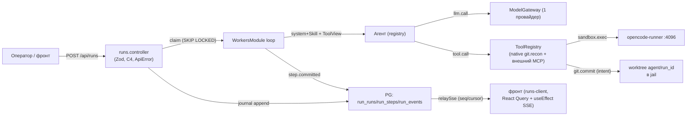

# ADR-0002. Прототип агентской системы (агенты + инструменты + инструкции в workflow)

| Поле | Значение |
| --- | --- |
| Статус | Proposed (Rev.2 — MCP только потребление, своего сервера нет, 2026-11-06) |
| Дата | 2026-11-06 |
| Автор | архитектурный ревью (режим проектирования) |
| Область | прототип: workflow-движок, агенты, tools/skills/MCP, журнал, SSE |
| Связано | `docs/adr/0001-cloud-agent-harness.md` — полное исследование (Rev.0–Rev.5, матрица A–G, источники №1–32); настоящий документ — сжатая 2-я итерация: только принятые решения + зафиксированные контракты |
| Стек | `bun@1.4.2`, NestJS 12, TS, `zod ^4.6.5`, `drizzle-orm ^0.45.3` + `pg ^8.12.5`, `nx`, `biome`, Next.js 16.3 Turbopack, React Query, `contracts/openapi.yaml` ↔ `@rush-code/contracts` |

Пометки: **[проверено]** — сверено с первоисточником (версия/дата указаны); **[решение]** — принято и фиксируется; **[todo]** — отложено с меткой в коде.

---

## 1. Зачем этот документ

ADR-0001 вырос в исследование (~1000 строк, 7 кандидатов, 32 источника). Для старта прототипа нужен короткий документ: что из исследования берём, что отбрасываем, какие контракты реализуем. ADR-0001 остаётся research-приложением; здесь — только то, что строим.

Фокус: **агентская система, которая применяет ИИ-агентов, инструменты и инструкции (skills) внутри workflow** — на существующем стеке, без новых сервисов (модулит), без per-run изоляции ресурсов (проект внутренний, Docker).

Принцип MCP (фиксируется): **наш сервис — потребитель MCP, а не поставщик. Своего MCP-сервера не реализуем** — нет своего MCP-endpoint, не хостим `server/discover`, `tools/list`, `subscriptions/listen`, `tasks/*` на серверной стороне. Агенты используют собственный набор внешних MCP-инструментов через наш MCP-клиент (`tools/call` + поллинг `tasks/get` для долгих инструментов).

---

## 2. Итоги исследования (сжато)

1. **MCP `2026-07-28` — stateless** **[проверено, modelcontextprotocol.io/specification/2026-07-28]**: нет `initialize`, нет `Mcp-Session-Id`, нет GET-стрима и `Last-Event-ID`; server→client — только MRTR (`InputRequiredResult` + повтор с `inputResponses`); задачи — расширение `io.modelcontextprotocol/tasks`; HTTP+SSE (2024-11-05) — Deprecated (окно ≥12 мес.); обязательные заголовки `MCP-Protocol-Version`/`Mcp-Method`/`Mcp-Name` + валидация соответствия телу (`HeaderMismatch -32020`); Roots/Sampling/Logging — Deprecated. Следствие: dual-era **клиент** обязателен на переходный период; журнал/resume/стриминг — наши, не MCP. Мы используем только клиентскую сторону (`server/discover` — как probe чужого сервера, `tools/list`/`tools/call` — как вызовы наружу, `tasks/get` — как поллинг чужих долгих инструментов); **серверную сторону спецификации не реализуем** (своего MCP-endpoint нет — см. принцип выше).
2. **Агентские SDK — исполнители, не ядро** **[проверено]**: `@openai/agents 0.21.0`, `@anthropic-ai/claude-agent-sdk 0.3.318`, `ai 7.0.162` + `resumable-stream 2.2.13` — у всех нет durable-журнала как источника истины; Claude SDK — обёртка над бинарником (чужой харнес). Используем как исполнителей за `Executor`-интерфейсом, модель — за узким `ModelGateway`.
3. **Durable-фреймворки — все мимо цели «из коробки»** (матрица ADR-0001 §6: C 371/93.7 %, G 330/83.3 %, A 328/82.8 %, D=F 314/79.3 % — ранжирование неустойчиво к ±1, решение держится на качественных аргументах): Temporal требует детерминизма кода + отдельный кластер (нарушает I6); LangGraph пере-исполняет LLM при replay; DBOS/Restate — ближайшая семантика, но как библиотека в монолите, не как сервис; Mastra-lease — advisory без fencing; Inngest — журнал вне нашей БД.
4. **Граф vs журнал:** чекпоинт состояния ≠ журнал эффектов; resume без повтора side effects даёт только effect log (`intent → confirm`, трейлер как identity, sha как наблюдения).
5. **Стек покрывает половину платформы**: `DbService` (строгий PG, 503 без fallback, testcontainers `postgres:16-alpine`), `relaySse` (probe-до-заголовков, abort, `x-accel-buffering: no`), `session-harness.streamEvents` (replay буфера + live-хвост), `REPOS_ROOT`-jail (`WorkspacePathService`), compose `opencode :4096` (`2G/2.0`, back-сеть) + `OpencodeSdkClient`, контракты `openapi.yaml` ↔ `packages/contracts` (zod v4, `ApiError`-envelope, `x-correlation-id`).
6. **Skills — формат зафиксирован** **[проверено, agentskills.io]**: `SKILL.md` (frontmatter `name ≤64`, `description ≤1024`, `allowed-tools` экспериментально) + `scripts/`, `references/`, `assets/`; progressive disclosure (метаданные → тело → ресурсы); `skills-ref validate` в CI.
7. **Git:** `git worktree` — одна ветка в одном дереве, `--lock` против prune; сабмодули — experimental **[проверено, git 2.56.0]** → в MVP флаг «без сабмодулей».
8. **OTel GenAI semconv нестабильны** (репо вынесено, schema URL `TODO`) → маппинг изолируем, корреляция едет через `AppLogger` + `x-correlation-id`.

---

## 3. Принятые решения (итог)

| # | Решение | Обоснование (коротко) | Где ляжет |
| --- | --- | --- | --- |
| D1 | Ядро V3: собственное event-sourced ядро на Postgres в монолите | Журнал как истина (FR5/FR6/I3); детерминизм кода не требуем; Temporal отклонён (кластер против I6), LangGraph — replay LLM, DBOS/Restate — только как библиотека | `processes/modules/runs/` + `processes/modules/workers/` |
| D2 | Исполнитель — существующий opencode-runner, без per-run ресурсов | Внутренний проект, Docker; логическая изоляция вместо microVM (jail + ветка/worktree + claim-loop + C4); E2B вне scope | compose `opencode`, `OpencodeSdkClient`, `WorkspacePathService` |
| D3 | Инструменты — `ToolDescriptor` + проекция `ToolView` | Политика в дескрипторе, модель видит только `{id,title,description,inputSchema,outputSchema?}`; префикс источника обязателен | `tool_defs`, §6.4 |
| D4 | Инструкции — skills как git-артефакты, эффект наследуется от скриптов | Progressive disclosure; `read` только для скиллов без `scripts/`; enforcement `allowed-tools` — наше | skills-лоадер, §6 |
| D5 | MCP — только потребление: stateless-клиент + один `initialize`-фолбэк в прототипе; своего MCP-сервера нет | Полный dual-era и Tasks-поллинг — после прототипа (`TODO(mcp-dual-era)`); серверную сторону (свой endpoint, `tools/list`-хостинг, `subscriptions/listen`, `tasks/*`-сервер) не проектируем и не реализуем | `ExternalClient`, §6 |
| D6 | Стриминг — `relaySse` + курсор `seq` из журнала | Переиспользуем `GET /api/sessions/events`-механику; MCP-потоки не проксируем | `GET /api/runs/:id/events`, §6.3 |
| D7 | Hot-reload — данными (`definitions.active`), пиннинг `definition_set_hash` на run | Граница — между шагами; идущий run не видит «свежий» текст (читаем по `commit_sha`) | `run_definitions`, `run.upgrade_definition` |
| D8 | Dual-write — `intent → confirm`, трейлер как identity | `committed` только после факта в git; push/PR — fail-closed с эскалацией | `run_effects`, §6.1 |
| D9 | Fencing в прототипе — упрощённый (`SKIP LOCKED`, `epoch` — `TODO`) | Полный fencing (`SELECT … FOR UPDATE`, `FOR UPDATE` по lease) — P1 после прототипа (`TODO(full-fencing)`); прототип переживает graceful-рестарт | `run_leases`, `WorkersModule` |

---

## 4. Инварианты (обязательны для прототипа)

- **I1** воркеры stateless; **I2** два носителя (БД-журнал + git); **I3** журнал — истина для восстановления.
- **I4** стек: bun/NestJS/Next.js/Drizzle/pg/contracts (п. выше).
- **I5** Forward-Only: `git merge-base --is-ancestor base HEAD`; только `revert`; `reset --hard`/`push --force` запрещены.
- **I6** Модулит: один деплоящийся NestJS-монолит (`processes/ → organizations/ → common/`); новые границы — только `<parent>/modules/<sub>/`; микросервисов/service mesh/кросс-сервисных саг нет.

---

## 5. Архитектура прототипа



---

## 6. Контракты (фиксируются, зеркало `openapi.yaml` ↔ `packages/contracts/src/runs/`)

### 6.1. Таблицы (`common/db/schema.ts`; soft-delete, `RESTRICT`, `project_id`-scope, `*Row`-типы; миграции `drizzle/`, `db:check-integrity`)

- `run_runs(id uuid PK, projectId uuid FK→projects RESTRICT, title text?, status, definitionSetHash, baseCommit, branch, worktree, sandboxId?, agentId?, model jsonb?, createdAt/updatedAt timestamptz defaultNow notNull, deletedAt?)`, индексы `(projectId)`, `(projectId,status)`.
- `run_steps(id uuid PK, runId FK RESTRICT, seq bigint per-run, type, status, attempt int, inputHash, idempotencyKey UNIQUE, observedEpoch int, resultRef jsonb?, error jsonb?, startedAt/endedAt?)`, `UNIQUE(runId,seq)`, индекс `(runId,status)`.
- `run_events(id uuid PK, runId FK RESTRICT, seq bigint per-run, type, data jsonb, prevHash, createdAt)`, `UNIQUE(runId,seq)`; UPDATE/DELETE запрещены политикой.
- `run_effects(id uuid PK, runId FK, stepId FK, class, status intent→committed|failed / committed→superseded, trailerRunId/trailerStepId, observations jsonb [{sha}], payload jsonb)`, `UNIQUE(runId,stepId)`, индекс `(trailerRunId,trailerStepId)`.
- `run_leases(runId PK FK CASCADE, holder, expiresAt, epoch)` — без soft-delete.
- `run_definitions(id uuid PK, kind, name, version, hash, contentRef, active bool, createdAt)`, `UNIQUE(kind,name,version)`, индекс `(active)`.

Статусы (frozen, новые значения — только через ADR): run `open|running|awaiting_human|failed|merged|abandoned`; step `pending|running|committed|failed|skipped`; типы шагов `llm.call|tool.call|sandbox.exec|git.commit|await_human|router`.

### 6.2. REST (`/api/runs*`, `VERSION_NEUTRAL`, `JwtAuthGuard` + C4 `ProjectAccessService`, `ZodValidationPipe`, envelope `ApiError {code,message,correlationId}` + `x-correlation-id`)

| Метод/путь | Вход | Успех | Ошибки |
| --- | --- | --- | --- |
| `POST /api/runs` | `CreateRunRequest {projectId: uuid, title?: 1..200, agentId?: ^[A-Za-z0-9][A-Za-z0-9_-]*$ 1..64, model?: SessionInfoModel, definitionSetHash?}` | 201 `RunInfo` | 400/404 (C4) / 503 `EXTERNAL_UNAVAILABLE` + `Retry-After: 30` |
| `GET /api/runs?projectId=` | `projectId: uuid` | 200 `RunInfoList` | те же |
| `GET /api/runs/:id` | — | 200 `RunInfo` | 404 / 503 |
| `POST /api/runs/:id/interrupt` | `{projectId: uuid}` | 200 `{interrupted: boolean}` (`false` = idle no-op) | те же |
| `POST /api/runs/:id/upgrade-definition` | `{projectId: uuid}` | 200 `RunInfo` + событие | 409 в терминальном |
| `GET /api/runs/:id/events?cursor=` | `cursor?: int ≥ 0` | 200 `text/event-stream` кадров §6.3 (до заголовков — JSON-ошибки через probe, после — только close) | 400/404/503 до заголовков |

`RunInfo {id: uuidv7 (`Bun.randomUUIDv7()`), projectId, title: string\|null, status, definitionSetHash, baseCommit, branch: agent/<id>, agentId\|null, model: SessionInfoModel\|null (reuse из sessions), createdAt/updatedAt: ISO-8601 Z}` — все nullable explicit, never optional.

### 6.3. SSE-кадры (расширение `SessionStreamFrame`)

```ts
type RunStreamFrameType =
  | "run.started" | "run.step.started" | "run.step.committed" | "run.step.failed"
  | "run.definition.upgraded" | "run.interrupted" | "run.merged" | "run.abandoned"
  | "secret.issued" | "secret.revoked";
type RunStreamFrame = { id: string; type: RunStreamFrameType; data: Record<string, unknown>; run?: string };
```

Правила: catch-up `seq > cursor` → live (`LISTEN/NOTIFY` несёт только `run_id + next_seq`); кадры без `run` дропаются; фильтр — scope gated-проекта; секреты/тексты arтефактов — только `{artifact_ref, hash}`; механика `relaySse` 1:1 (probe → честный 503, abort на disconnect, `x-accel-buffering: no`, `return()`-гонка 1500 мс). Прототип реализует 4 типа (`started/step.started/step.committed/step.failed`), остальные — схема + `TODO`.

### 6.4. Инструменты

```ts
toolId = z.string().regex(/^(mcp|skill|native):[a-z0-9/_-]+$/);
ToolDescriptor = { id, title 1..200, description 1..2000, inputSchema (object), outputSchema?,
  source: mcp|skill|native, transport?: { kind: "streamable-http", endpoint: url, protocolVersion, era: modern|legacy|dual }, // только клиентская сторона: куда звоним мы; своего endpoint нет
  effects: { class: read|write-local|write-external, idempotent: bool, compensable: bool },
  limits: { timeoutMs 1..300000, maxBytes ≤8МБ, concurrency 1..8 },
  auth: { mode: none|oauth|broker-token, scopes: string[] }, version: string };
ToolView = pick(id, title, description, inputSchema, outputSchema); // единственное, что уходит в модель
```

### 6.5. Машины состояний (переход только с событием)

- run: `open → running ⇄ awaiting_human → merged | abandoned`; `failed` из `running/awaiting_human`; терминальные без выходов; `upgrade-definition` в терминальном → 409.
- step: `pending → running → committed | failed | skipped`; `running → pending` только через fencing-reclaim (`attempt+1`).
- effect: `intent → committed | failed`; `committed → superseded` (только rebase-правило §9.3 ADR-0001).

### 6.6. Раскладка (CoC v2)

```
packages/contracts/src/runs/{runs.ts,runs.schema.ts,index.ts} + openapi.yaml (components/schemas Run*, paths /api/runs*)
apps/backend/src/common/db/schema.ts (таблицы §6.1) + drizzle/ (миграция) + schema-integrity
apps/backend/src/processes/modules/runs/ (controller/service/dto) + processes/modules/workers/ (claim-loop, leases/outbox, reconciliation-TODO)
apps/frontend/src/api/runs-client.ts (фасад над client.ts) + hooks/ + query-keys.ts (useRuns/useRun/useRunEvents; SSE — useEffect-исключение)
apps/backend/.../__tests__/runs.e2e.ts (testcontainers, образец sessions.e2e.ts)
```

---

## 7. План прототипа (7 шагов, каждый независимо проверяем)

1. Контракты-минимум: `runs.ts`/`runs.schema.ts` (только `RunInfo`, `CreateRunRequest`, `RunStreamFrame` из 4 типов) + `openapi.yaml`-патч.
2. БД-минимум: `run_runs` + `run_steps` + `run_events` (+ упрощённая `run_leases` без `epoch`); `schema-integrity` зелёный.
3. API-минимум: `POST /api/runs`, `GET :id`, `GET :id/events` (relaySse, probe, C4).
4. Движок-минимум (in-process в `WorkersModule`): `claim → llm.call (1 провайдер) → tool.call (native git.recon + 1 внешний MCP-сервер, мы — клиент) → sandbox.exec (:4096) → step.committed → SSE`.
5. Агенты + инструкции: реестр (`AgentBase` + `AskAgent`), skills-лоадер (1 пилот-скилл: frontmatter → тело в системный промпт; `allowed-tools` — deny по умолчанию).
6. Фронт-минимум: `runs-client.ts` + `useRuns` + SSE-аналог `streamSessionEvents`.
7. E2E-минимум: создать run → `step.committed` → переподключение с `cursor` → replay; asserts: jail-путь, ветка `agent/<id>`, чужой `projectId` → `404`.

Критерий готовности: сквозной run по §18.1 ADR-0001 (tool вызван, журнал записан, SSE показал цепочку, worktree в jail, replay без потерь).

Отложено с метками (не молча): `TODO(full-fencing)`, `TODO(dual-write-reconcile)` (git-ошибка = `step.failed`), `TODO(mcp-dual-era)` (modern + 1 `initialize`-фолбэк), биллинг/SLA/OTel/per-run ресурсы.

---

## 8. Риски и лимиты прототипа (честно)

- Переживает graceful-рестарт, не `kill -9` посреди шага (нет полного fencing).
- Нет авто-догона git (`intent` без reconcile) — оператор видит `failed` и решает.
- Один MCP-клиент (modern + минимальный фолбэк) к внешним серверам — часть серверов останется legacy; фиксируем матрицей пилота. Своего MCP-сервера нет — серверные пункты чек-листов MCP-спецификации к нам неприменимы.
- Квоты общие (compose `2G/2.0` + диск); параллельных run — «десятки», мерим e2e-стендом.
- Сабмодули — флаг «без сабмодулей».

---

## 9. Связи

- Полное исследование, матрица A–G, источники №1–32, детальные §9.1–§9.9: `docs/adr/0001-cloud-agent-harness.md` (Rev.0–Rev.5).
- Канон: `AGENTS.md`, `apps/backend/{AGENTS.md,ARCHITECTURE.md}`, `apps/frontend/AGENTS.md`, `packages/contracts/AGENTS.md`, `docs/auth-decision.md`, `docs/backend-hardening-plan.md`, `docs/env-validation.md`, `contracts/openapi.yaml`, `docker-compose.yml` (полный разбор — ADR-0001 §16).
